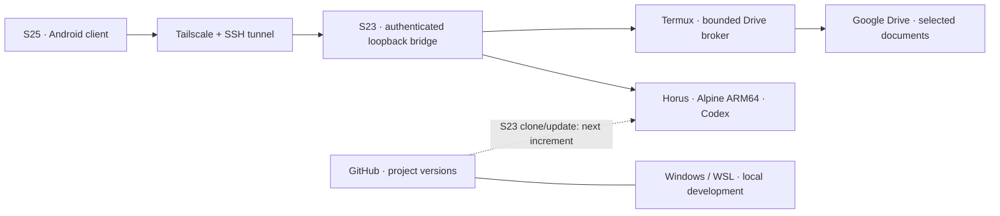

# MESTRY

**An Android/Linux development workspace with Codex, remote access, and controlled document publishing.**

MESTRY explores using a Galaxy S23 Ultra as a persistent ARM64 development node,
with a Galaxy S25 Ultra as its mobile interface and Windows/WSL as an independent
local development environment. Work continuity is based on project files and Git
versions; agent accounts and conversations remain independent.

This repository contains the integration tooling, an audited Android/bridge patch,
offline tests, and technical research. It is a working experimental project,
with availability and cross-device synchronization limits documented explicitly.

## Architecture



## Project contributions

- **Mobile client integration:** adapts an existing Kotlin/Compose client to the
  S23 environment, including project/document navigation and task activity.
- **Authenticated bridge:** validates HTTP/WebSocket requests, thread policy,
  project paths and effective backend settings; rejects unauthenticated requests.
- **Separated document access:** OAuth stays in Termux; Horus uses a restricted
  SSH command interface for bounded publication and selected-document browsing.
- **Versioned publication:** immutable Markdown revisions, idempotent retries,
  size limits, and SHA-256 read-back verification.
- **Operational tooling:** device identity checks, metadata-only diagnostics,
  SSH migration guards, and bridge ownership checks before recovery actions.
- **Reproducible changes:** pinned upstream revision, a reviewed patch and
  per-file hashes for 68 modified client/bridge source files.

The Android client and bridge build on
[chenhaoc/codex-remote-control](https://github.com/chenhaoc/codex-remote-control),
not a client written entirely from scratch. See
[third-party attribution](THIRD_PARTY_NOTICES.md).

## Verified scope

- Codex runs in Horus/Alpine ARM64 on the S23; remote access from the S25 was
  confirmed by the user after service recovery.
- **82 local tests** pass: 54 publication/browser/OAuth fixtures, 4 deployment
  helpers, 8 recovery/network-observation tests, 13 pairing-boundary tests and
  3 Node policy tests. They do not use real credentials or model inference.
- The pinned archive and patch reproduce **68 text files** with matching hashes.
- Live Drive publication and FolderSync transfer/read-back were separately
  exercised; the offline test suite does not stand in for those device tests.

This does **not** establish 24/7 availability, reboot recovery, or automatic Git
updates on the phone. The workspace policy is not an OS security sandbox. The
full-access mode used by the personal Horus deployment is a documented exception,
not a safe default for arbitrary projects.

## Run the offline checks

Tested locally with **Python 3.12.3** and **Node.js 22.23.1**. These checks use
Python's standard library and Node built-ins; they do not install packages or
contact the phones, Google accounts, or model services.

```sh
python3 -B -m unittest discover -s tools/horus_publish -p 'test_*.py'
python3 -B -m unittest discover -s tools/s25-codex-client -p test_helpers.py
python3 -B -m unittest discover -s tools/s23-remote-access -p 'test_*.py'
python3 -B -m unittest discover -s tools -p test_horus_pair_s25.py
node --test tools/s25-codex-client/pilot-policy.test.mjs
```

Backend integration tests that import `../src/` belong in the reconstructed
upstream tree. See [client build and reproduction](tools/s25-codex-client/README.md)
and [source pins](tools/s25-codex-client/source-pins.json).

## Repository map

| Path | Purpose |
|---|---|
| `tools/s25-codex-client/` | Client/bridge patch, policy, source reproduction and deployment helpers |
| `tools/horus_publish/` | Bounded publisher, document browser, OAuth helpers and offline tests |
| `tools/s23-remote-access/` | Identity checks, transport diagnostics and bridge supervisor |
| `tools/horus_pair_s25.py` | Explicit pairing helper that keeps passwords out of arguments/logs |
| `docs/investigaciones/2026-10-26_codex_24x7/` | Architecture revision, H0 verification and subsequent repairs |
| `docs/LOCAL_CONFIGURATION.md` | Public examples versus deployment-specific configuration |
| `AGENTS.md` | Instructions for continuing work from files and evidence |

## Current direction

Use a separate Git clone and platform-local dependencies in each development
environment. Google Drive remains authoritative for selected original documents;
Git stores code and repository-owned technical documentation. Avoid mirroring
live Git databases, Codex homes, dependencies or databases with file synchronizers.

See the [architecture reorientation](docs/investigaciones/2026-10-26_codex_24x7/09_REORIENTACION_CONTINUIDAD_TRABAJO.md)
and [publication record](docs/GITHUB_PUBLICATION.md).

## Public edition and evidence

Device identifiers, deployment addresses, account details and local key pins have
been replaced with examples in this public edition. Raw screenshots, UI dumps,
logs, command output and private runtime state are not published. Historical
reports may link to evidence retained in the original local archive; those links
are not all available in a fresh clone. Historical PASS results retain their
original scope and date.

Device/setup scripts are operator tools, not an automatic installer. Read
[local configuration](docs/LOCAL_CONFIGURATION.md) before using them; do not run
old migration or OAuth steps against an existing deployment as a test.
