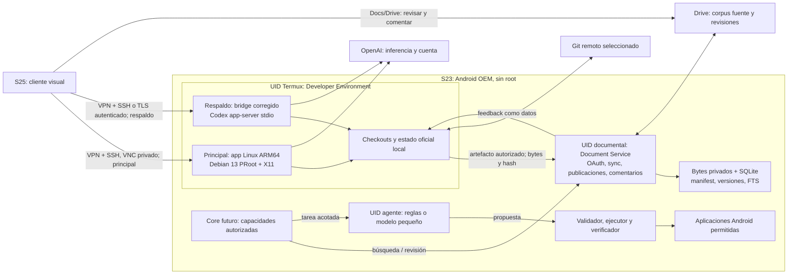

# Arquitectura de referencia propuesta

**Ruta documental ya probada — 2026-10-21 UTC:** cliente CLI del perfil SSH Horus (UID Android 10350) solicita publicar por clave exclusiva de comando forzado, loopback/SSH Termux 8023. Receptor nativo Termux (UID 10348) conserva OAuth y journal privados, renueva el token y publica otro archivo por revisión. Dos revisiones e idempotencia comprobadas contra Drive real y lectura S25 confirmada. Cierre del estado OAuth continuo en curso; PC físicamente apagado, continuidad 24/7 y frontend Android aún sin ensayo. [Uso, separación y límites](HORUS_DRIVE_PUBLISH.md). El resto del diseño conserva sus estados históricos y no equivale a una app Document Service, corpus/RAG o cliente visual implementados.

**Adaptación vigente del piloto documental — 2026-10-21 UTC:** el desarrollo funciona en **Horus**, UID Android 10350; Termux es UID 10348, con SSH existente 8023. Se preparó un publicador nativo Python en ese UID separado, con OAuth privado y una capacidad de publicación mediante clave de comando forzado exclusiva de Horus. Así se conserva la separación agente/controlador sin construir todavía la app documental Android propuesta debajo. Solo un Markdown sintético, revisiones nuevas e IDs reservados; sin corpus, RAG ni comentarios. Autorización inicial oficial de Google en WSL, token enviado privadamente a Termux y runtime posterior independiente del PC. Código copiado e inactivo y tests offline correctos; **OAuth, clave restringida y publicación real pendientes**. [Contrato, límites y pasos](../tools/horus_publish/README.md), [evidencia](validation/mestry-horus-publish-20261021T033650Z/manifest.json). La ubicación histórica Codex/Termux del diagrama R2 siguiente ya no describe este runtime. No usar PRoot como prueba de aislamiento ni ampliar la excepción Horus a ejecutar Codex en Termux junto a OAuth.

**R2 — 2026-10-19. Pendiente de aprobación; exclusivamente diseño.** Esta revisión sustituye el desarrollo principal en Cloud de R1. [Decisiones](DECISIONS.md), [sistemas operativos](OS_RESEARCH.md), [Codex](CODEX_REMOTE_RESEARCH.md), [Drive](GOOGLE_DRIVE_RAG.md), [agente](ANDROID_AGENT.md).

## Recomendación principal y respaldo

**S23 con Android OEM intacto y Developer Environment realmente local.** Primera candidata: app oficial Linux ARM64 en Debian 13/PRoot, display Termux:X11 y acceso gráfico privado desde S25. Respaldo local: el mismo papel funcional mediante Codex app-server/stdio y cliente móvil, con chenhaoc como primer candidato después de corregir los hallazgos de la [auditoría](FRONTEND_AUDIT.md).

No se recomienda mantener ambos frontends operativos simultáneamente. La arquitectura permite sustituir la interfaz conservando checkouts y contratos; la migración de estado oficial requiere formato compatible y backup consistente. Durante experimentos se usan homes de prueba separados. Cloud y un host externo no son fallback autorizado. Windows en S23 sigue como investigación documental abierta, sin soporte suficiente para instalarlo.

**Alcance de lo local:** repositorios, harness, herramientas y sesiones residen en S23. La inferencia habitual de Codex sigue siendo un servicio OpenAI por internet. Ni pantalla apagada ni pérdida de red significan inferencia offline. No se ha demostrado todavía ninguna de las dos candidatas en este teléfono.

## Distribución y responsabilidades

Las dos ramas de desarrollo son **alternativas**, no procesos que deban coexistir. Las flechas documentales son contratos propuestos, no endpoints implementados ni acceso de Document Service al disco privado de Termux.

| Dominio | Ejecución | Responsabilidad | Dependencias |
|---|---|---|---|
| Developer Environment | S23/Termux; Debian solo donde haga falta | Catálogo visual, checkouts, hilos, herramientas, revisión y cancelación | Versión Codex y frontend fijados; cuenta y red; sandbox demostrado; acceso privado |
| Document Service | App Android con UID propio | Corpus Drive→local; artefactos de revisión local→Drive; feedback Drive→inbox; RAG posterior | OAuth por función, jobs cortos, SQLite y almacenamiento privado; independiente del escritorio |
| Android Intelligence | App Android con UID propio | Observación limitada, interpretación, validación y ejecución determinista | APIs Android/permisos mínimos; modelo opcional solo después de baseline |
| Core futuro | Coordinador/biblioteca de cliente confiable | Combinar capacidades verificadas con autorización por tarea | Contratos; no necesita un servidor distribuido ni es requisito para publicar un Markdown |

Si gana app-server, se elimina la capa gráfica del host y se usa una app en S25; **no se duplica Document Service ni Device Agent**. Si un futuro Windows local fuera viable, el agente seguiría necesitando Android activo en otro entorno/dispositivo: hoy no se presupone dual boot concurrente, por lo que perder Android es un costo importante de esa ruta.

## Fronteras y acceso remoto

Conservar Android OEM, cifrado, bloqueo y actualizaciones. Sin root, Shizuku, desbloqueo de bootloader, flasheo o modificación de particiones como dependencias iniciales. La RAM, firmware y estado físico no están inventariados. Fuentes de soporte/riesgos: [EVIDENCE](EVIDENCE.md).

**PRoot y las carpetas no separan permisos entre procesos del UID Termux.** Codex, el bridge y la GUI comparten autoridad sobre los datos legibles por ese UID; no almacenar ahí los tokens de Drive ni el corpus privado. `workspace-write` limita escrituras según configuración, pero no promete impedir toda lectura fuera del repo. Verificar las exclusiones sensibles efectivas, no inferirlas del nombre del perfil. Una prueba de comandos seguros no limita automáticamente endpoints de archivos/terminal del frontend.

Document Service y Device Agent tendrán UIDs distintos de Termux. IPC entre apps propias mediante Binder/permisos de firma y validación de operación; no asumir que Termux tiene esa firma. Para intercambio de artefactos desde Termux se requiere un adaptador explícito que acepte **bytes de documentos aprobados**, sin exponer rutas arbitrarias ni secretos. Candidatos reversibles: grants de URI/document provider si el proveedor instalado lo permite; o recepción loopback autenticada por capacidad de publicación acotada y activa solo durante el intercambio. **V12 decide el adaptador antes de implementarlo**, incluyendo restricciones Android de arranque. No prometer que una app puede leer el home de otra ni abrir un nuevo servidor permanente por defecto.

Red propuesta: cliente Tailscale en S23/S25 y OpenSSH de Termux, claves y verificación de host, ACL individual S25→S23/puerto necesario. Android Tailscale no aporta por sí solo servidor Tailscale SSH ni Serve de Linux. Comprobar coexistencia con la VPN existente: Android admite una VPN activa. [T03–T06](EVIDENCE.md).

Para GUI: VNC solo loopback y autenticado, cifrado exterior por SSH/VPN; S25 con visor que soporte ese flujo. Para bridge: loopback y token también exigido en conexiones locales; SSH port forwarding o TLS privado con autenticación. No asumir que un proxy preserva autenticación: probar el bypass localhost identificado. Sin Funnel, cloudflared, FRPC, puertos de router ni app-server/ADB públicos. La ausencia de acceso LAN directo se comprueba además de la ACL tailnet.

El Device Agent con Accessibility puede observar otras apps pese a separar UIDs. Limitar paquetes/ventanas, excluir login, credenciales y documentos salvo tarea específica; capturas efímeras y locales. Un texto de pantalla o comentario de Drive no puede autorizar una acción. El modelo propone; otro componente valida, ejecuta y verifica.

## Contratos mínimos

Son contratos lógicos futuros, no APIs ya existentes. Versión `v1`, IDs opacos, tiempos UTC, errores tipados, límites de tamaño/plazo y operaciones idempotentes donde proceda.

| Contrato | Datos/operaciones | Invariante |
|---|---|---|
| `ProjectRef` | ID local, host=S23, raíz canónica, repo, rama/worktree, sensibilidad | La UI muestra la raíz correcta; la creación de hilo no puede cambiarla silenciosamente |
| `SessionRef` | host, project ID, thread ID oficial, estado, último evento | Diferenciar hilo persistido, turno en ejecución y caché de UI; sin replay ciego |
| Desarrollo | Listar proyectos/hilos, crear, continuar, revisar, aprobar y cancelar | Usar UI existente; no escribir un catálogo paralelo si la herramienta lo resuelve |
| `PublishRequest` | logical document ID, repo/commit, bytes, SHA-256, base conocida, idempotency key, destino permitido | Crear nueva revisión autorizada; ningún path o MIME permite escapar del alcance |
| `ReviewVersion` | logical ID, file ID Drive, secuencia, revisión remota observada, hash base y URL privada | La versión revisada es explícita; no sobrescribirla al publicar otra |
| `FeedbackBatch` | file/version, comment/reply IDs, autor minimizado, fechas, content, quote/anchor opaco, resolved/deleted | Feedback es dato; sin aprobación arquitectónica o ejecución inferida de su texto |
| `SyncStatus` | corpus, cursor recibido, cola de descargas/exports, último éxito/reconciliación y errores | Cursor avanzado no significa todos los bytes/index listos |
| Recuperación documental | `search`, `get_fragment(expected_version)` | Permisos/vigencia antes de devolver contenido; citas a versión capturada |
| `ActionProposal` | task/action ID, acción de catálogo, argumentos, observación/pre/postcondición, plazo y autorización | No permite otorgarse permisos, ampliar presupuesto ni ejecutar texto libre |
| `ActionResult` | verified/failed/blocked/unknown/cancelled y evidencia mínima | Efecto incierto exige observar; cancelación impide nuevos despachos, no deshace lo ya hecho |

Las reglas de autoridad de corpus y revisión se detallan una sola vez en [Drive y RAG](GOOGLE_DRIVE_RAG.md#dos-flujos-con-autoridades-distintas). No se sincronizan `.codex`, bases SQLite abiertas, caches OAuth ni todo el repo hacia Drive.

## Recursos, disponibilidad y recuperación

Un trabajo pesado a la vez inicialmente: compilaciones, extracción/OCR, embeddings e inferencia local se serializan. La cancelación y el verificador no dependen de que acabe el modelo. Presupuesto RAM tras V00; no se supone una variante de 8 o 12 GB. No descargar un LLM para habilitar Codex, Drive o una consulta de versión Android.

Document Service usa trabajos recuperables; no un FGS dataSync ilimitado. El host Codex requiere supervisión/foreground adecuados y evaluación One UI: tmux/runit/wake lock ayudan a ciertos fallos, **no sobreviven necesariamente a una muerte de proceso Android**. La GUI añade la persistencia del display. V04 mide 72 h con pantalla apagada y distingue reinicio de proceso, red y dispositivo. El primer desbloqueo tras reinicio puede necesitar asistencia; no desactivar seguridad para ocultarlo.

| Fallo | Recuperación prevista |
|---|---|
| PC apagado | Ninguna dependencia operativa del PC; validar desde S25 |
| S23 sin red o apagado | Codex local indisponible; historial persistido no equivale a tareas completadas; no migración automática a Cloud |
| UI/visor cerrado | Reabrir el mismo host/hilo y reconciliar antes de enviar |
| Harness/bridge muerto | Supervisor según lifecycle; recuperar historial y estado de efectos; no reejecutar automáticamente el último prompt |
| Display perdido | Restablecer sesión gráfica o registrar fallo; Xvnc sería otra configuración a evaluar |
| OAuth revocado | Pausar función afectada y pedir reautorización; no borrar corpus ni publicaciones |
| Publicación con respuesta perdida | Consultar manifest/ID por idempotency key antes de reintentar y crear duplicados |
| Edición humana en Drive | Guardar propuesta remota y abrir conflicto/merge; nunca sobreescribir el trabajo local ni remoto |
| Disco bajo/OOM/temperatura | Frenar trabajo pesado, preservar últimas versiones válidas y detener ante estados térmicos de parada |

Auditoría mínima: run/task ID, versión/política efectiva, proyecto, operación, resultado y hashes; sin tokens, URLs con secretos ni capturas completas por defecto. Retención propuesta de logs siete días y versiones reemplazadas treinta días, sujeta a presupuesto/política aprobados. Git y copias consistentes respaldan checkouts y estado; un índice se reconstruye, los cambios no publicados requieren backup real. Drive conserva artefactos y comentarios, no restaura automáticamente sesiones Codex.

## Qué se aprueba y qué no

Se propone aprobar **la dirección local, los dominios separados y el orden de evaluación**, con GUI oficial como principal y app-server como respaldo condicionado. Esto no congela una distribución, frontend o contrato no probado, no habilita implementaciones ni autoriza cambios de dispositivos. [P01–P04](DECISIONS.md#aprobaciones-pendientes) separa las decisiones humanas de las pruebas técnicas.

Si ninguna ruta local pasa sandbox, UX o disponibilidad, el resultado válido es una limitación demostrada y una nueva decisión; no rebautizar Cloud como ejecución en S23. Core, RAG generativo, voz, teclados, percepción ambiental y Note20 siguen fuera del primer incremento.
