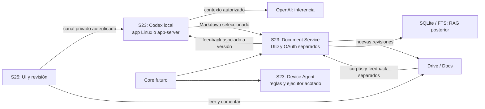

# MESTRY: informe ejecutivo para aprobación

**R2 — 19 de octubre de 2026, America/Santiago. Investigación/documentación únicamente.** Sustituye la recomendación Cloud no aprobada. [Fuentes y límites](EVIDENCE.md), [registro de decisiones](DECISIONS.md).

## 1. Diagnóstico general

El S23 conserva valor como host Android para documentos, herramientas y agente. Hay una **ruta local razonable que merece pruebas**, pero no una solución ya demostrada: app oficial Linux ARM64 sobre Debian 13/PRoot, o Codex app-server y cliente móvil. No se inspeccionó el teléfono; RAM, firmware, variante y disponibilidad real permanecen desconocidos.

La corrección principal es tratar **ejecución en S23, ausencia de PC y UX visual multiproyecto como puertas obligatorias**, no como ventajas compensables con Cloud. La [matriz](OS_RESEARCH.md#matriz-ponderada-y-puertas-obligatorias) conserva criterios/pesos, pero no inventa totales mientras falten compatibilidad, seguridad y métricas.

## 2. Codex: principal y respaldo locales

**Principal condicionada: app oficial Linux ARM64 en Debian 13/PRoot + Termux:X11**, con escritorio compartido privadamente hacia S25. OpenAI publica soporte Debian 13 desktop y ARM64; no soporte Android/PRoot. Se aproxima más al catálogo/hilos de escritorio y evita un bridge de terceros, a cambio de capas gráficas y riesgo de sandbox. [Fuente oficial](https://learn.chatgpt.com/docs/linux/linux-app), [investigación](CODEX_REMOTE_RESEARCH.md).

**Respaldo: app-server/stdio en S23 + cliente móvil**, empezando por chenhaoc solo después de correcciones. Menor pila del servidor y sin escritorio completo; no garantiza la misma UX. Scouthe ofrece catálogo más amplio, pero añade socket compartido y superficie operativa. Friuns2 queda detrás. Ninguno es adoptable con sus valores actuales sin controles. [Auditoría](FRONTEND_AUDIT.md).

Hallazgos decisivos: friuns2 fuerza acceso completo/sin aprobaciones; scouthe conserva activación condicional de túnel pese al flujo recomendado; chenhaoc también tiene fallback `dangerFullAccess`. Además hay acceso de archivos fuera de cwd, tokens amplios y condiciones de bypass localhost. Son hechos de versiones fijadas, no demostraciones de explotación ni mediciones en S23.

## 3. Windows ARM específico del S23 Ultra

La investigación queda **abierta**, pero hoy no se puede recomendar instalación. Existe trabajo SM8550 y una plataforma dm1q para S23 base; no se encontró puerto dm3q/SM-S918 Ultra con drivers, recuperación y energía suficientes. La variante del usuario tampoco está comprobada. Un TWRP/kernel Android o puerto Xiaomi no valida Windows para esta placa.

Existe MSIX oficial Windows ARM64, pero es un segundo nivel: no prueba login, comandos, sandbox o estabilidad sobre un port sin drivers. Windows 10 no resuelve estos bloqueos. No se propone desbloquear, flashear ni particionar para investigar. [Requisitos y evidencias](OS_RESEARCH.md#windows-arm-nativo-investigacion-abierta-instalacion-bloqueada).

## 4. Termux y PRoot

Termux permite alojar herramientas sin reemplazar Android; PRoot aporta userland Debian/glibc, no otro kernel ni aislamiento entre procesos del mismo UID. Termux:X11 es display local, no acceso remoto S25. TigerVNC sobre el mismo display y SSH privado es una hipótesis concreta a probar; x11vnc no se prefiere por su estado de mantenimiento.

Hay reportes actuales y específicos de sandbox en Debian 13/PRoot, startup locks y regresiones Unix nativas. Un login o handshake correcto no acredita herramientas seguras. **No se contará como éxito desactivar sandbox del renderer, usar full access o dar root.** [N01–N08](EVIDENCE.md#revision-r2-fuentes-nuevas).

## 5. Remote oficial y Cloud

Remote oficial documenta hosts Mac/Windows conectados y despiertos, clientes móviles sujetos a disponibilidad y desktop→SSH. No convierte la preview Linux o un daemon Termux en host móvil oficialmente soportado. Por eso la principal propone acceso gráfico privado, y el respaldo un cliente de app-server; ambos son flujos distintos. [Documentación oficial](https://learn.chatgpt.com/docs/remote-connections).

Cloud ejecuta tareas fuera del S23 y puede ser útil con independencia del PC, pero **no está aprobado como principal ni como sustitución automática**. Tampoco una sesión tmux equivale a la app multiproyecto. En las dos candidatas locales, el modelo OpenAI habitual requiere internet y recibe contexto; local se refiere al harness, checkouts y herramientas, no a inferencia offline.

## 6. Google Drive como interfaz de revisión

El [anuncio oficial del 5 de octubre](https://workspaceupdates.googleblog.com/2026/10/preview-edit-and-collaborate-on-Markdown-files-natively-across-Drive-and-Docs.html) confirma edición/comentarios de Markdown sin conversión, con rollout gradual. **Falta demostrar experiencia real en S25 y acceso API a esos comentarios.** No se presupone que apps Android y web tengan igual soporte.

Flujo propuesto: Codex escribe `.md` local → selección/autorización → publicador con OAuth independiente crea revisión privada nueva → S25 revisa/comenta → API oficial recupera feedback con file/comment/reply ID y base → Codex prepara otra versión. Un archivo por publicación evita que el publicador sobrescriba un documento editado por el usuario. Comentarios/anclas no se trasladan automáticamente a otra versión; ediciones humanas generan propuesta/merge, nunca overwrite.

El corpus original mantiene Drive→local de solo lectura y no se mezcla con Review. Drive API v3, SQLite, trabajos cortos y scopes por función; rclone se contrasta antes de construir, pero no sustituye por sí solo comments/versiones. Un comentario es dato, no autorización de acciones. [Diseño y API](GOOGLE_DRIVE_RAG.md).

## 7. Device Agent

Se mantiene el diseño separado: APIs oficiales → función determinista → macro específica → Accessibility/visión. Modelo propone, validador aplica catálogo/límites, ejecutor actúa y verificador comprueba. UID distinto de Termux y Document Service; Accessibility también requiere excluir ventanas sensibles. DroidRun/Mobilerun, Android Use, UIAutomator y Appium siguen como referencias, sin atribuir autonomía local a herramientas alojadas en PC. [Investigación conservada](ANDROID_AGENT.md).

## 8. Modelo local

No es requisito de Codex ni del flujo documental. Baseline reglas/clasificador; llama.cpp CPU y candidatos pequeños Qwen3-1.7B, FunctionGemma 270M y, posteriormente, Qwen3.5-2B/visión. Español, templates, tool calling, RAM y temperatura siguen sin medir. No se descargó ninguno. V08 compara propuestas sin actuar; V09 demuestra Configuración con API y UI verificadas; V10 evalúa convivencia.

## 9. Arquitectura y responsabilidades

Se elige **una** UI operativa después de pruebas, sin duplicar infraestructura de documentos/agente. No se comparten OAuth, bases vivas ni todo el almacenamiento del UID. El intercambio desde Termux al servicio Android requiere adaptador explícito: no asumir acceso entre sandboxes. [Arquitectura y contratos](ARCHITECTURE.md).

## 10. Decisiones pendientes de aprobación

Solo [P01–P04](DECISIONS.md#aprobaciones-pendientes): dirección local y respaldo condicionado; datos/gasto permitidos para Codex; autoridades/scopes/publicaciones documentales; alcance posterior del agente. Compatibilidad del paquete, kernel y APIs son cuestiones de investigación/prueba, no elecciones que deba adivinar el usuario. Aprobar diseño no autoriza instalar ni experimentar en esta ejecución.

## 11. Roadmap priorizado

1. Aprobar dirección; V00 e inspección del artefacto. V01 app oficial primero.
2. V02 respaldo si hace falta; V03 con tres repos desde S25/PC apagado; V04 de 72 h y V11 antes de uso personal.
3. Entregar un único entorno Codex local verificable. Si ambas ramas fallan, informar el bloqueo antes de ampliar arquitectura.
4. V12/V13: revisión Markdown y comentarios; V05/V06: corpus incremental offline. Compartir servicio/manifest, no destinos escritores.
5. V09 y V08: agente determinista y modelos opcionales; V10 convivencia. Después FTS/RAG y Core si aportan valor.

[Dependencias y criterios de salida](ROADMAP.md).

## 12. Experimentos y puertas de descarte

| Protocolo | Qué debe demostrar | Descartar/detener si… |
|---|---|---|
| V00 | Modelo/firmware/RAM/recursos reales | El inventario no permite fijar el artefacto/alcance |
| V01 | App Linux, gráficos, auth, herramientas y sandbox en PRoot | Solo arranca desprotegida o depende recurrentemente del PC |
| V02 | Harness y bridge corregido, privados, con permisos efectivos | Bypass, lectura fuera de alcance, escalada o fallo común del sandbox |
| V03 | Tres repos/seis hilos y recuperación S25 con PC apagado | Requiere shell por repo, pierde estado o duplica efectos |
| V04 | 72 h con pantalla apagada/red y recuperación medidas | Disponibilidad insuficiente o intervención física/PC rutinaria |
| V12/V13 | Markdown real, comentarios API, versiones/conflictos | Conversión inesperada, comentarios inaccesibles, pérdida o overwrite |
| V05–V11 | Corpus, OAuth, RAG/agente, recursos y fronteras | Fallos de integridad, privacidad, cancelación o permisos |

Protocolos con fixtures, pasos, métricas, riesgos y rollback en [VALIDATION_PLAN](VALIDATION_PLAN.md). Todos **NO EJECUTADOS**. Los umbrales son propuestas; no hay benchmarks del S23 ni instalaciones actuales que certificar.

## 13. Documentación y respuestas directas

Workspace: `/home/developer/proyectos/mestry`. Se actualizan README, este informe, arquitectura, OS, Codex, Drive/RAG, decisiones, roadmap, validación y evidencia; se añade **FRONTEND_AUDIT.md**. La investigación del agente queda conservada, sin nueva selección de modelos. El documento antiguo con “Congelada” en su nombre se preserva y no equivale a aprobación.

| Pregunta inicial | Respuesta R2 |
|---|---|
| ¿Windows 11 ARM nativo funcional y seguro? | No demostrado para S23 Ultra; no recomendar instalación con la evidencia actual |
| ¿Soporte de dispositivo/variante? | No se identificó puerto Ultra completo; variante propia aún desconocida |
| ¿App Windows Codex allí? | Paquete ARM64 existe; sobre ese port no se puede confirmar |
| ¿Windows virtualizado suficientemente útil? | No hay evidencia de rendimiento/estabilidad de la app completa en este S23 |
| ¿Termux multiproyecto práctico? | Dos candidatas visuales concretas, pendientes de seguridad/UX/continuidad |
| ¿Remote oficial actual? | Host Mac/Windows despierto, pairing y rollout; SSH de desktop no es móvil directo a cualquier CLI |
| ¿Local frente a Cloud? | Local: comandos/repos en S23; Cloud: workspace del proveedor; inferencia OpenAI puede ser remota en ambos |
| ¿UX de escritorio sin Windows? | La app oficial Linux es la aproximación más directa; PRoot y remoto S25 sin demostrar |
| ¿Pantalla apagada prolongada? | Posible hipótesis local, requiere V04; display, VPN y procesos separados; reinicio/primer desbloqueo son otro caso |
| ¿Menor mantenimiento/riesgo que cumpla lo local? | Android intacto y una sola UI; GUI oficial evita fork, app-server evita gráficos; decidir tras puertas y medidas |
| ¿Combinar Codex, Drive y Android sin complejidad extra? | Tres dominios, UIDs/permisos y contratos; revisión sin Core/RAG obligatorios |
| ¿Qué validar antes de comprometernos? | V00–V04/V11 para Codex; V12/V13 para Review; corpus/agente/RAG después según alcance |

## Arquitectura que se recomienda aprobar

**Android OEM en S23 + Codex local con app oficial Linux ARM64/Debian 13/PRoot/Termux:X11 como candidata principal + acceso gráfico privado desde S25; app-server/stdio con cliente móvil corregido como respaldo local; Document Service Android separado con publicaciones Markdown privadas/versionadas y feedback por API; Device Agent determinista separado y Core posterior.**

Supera Cloud/hosts externos porque mantiene la ejecución en el hardware del usuario; supera Windows/VM porque conserva drivers Android y evita un port no acreditado o un guest pesado; prioriza la app oficial para conservar proyectos/hilos antes de mantener un frontend propio. **Se aprueba la dirección, no una compatibilidad ni arquitectura congelada.** La adopción sigue condicionada a sandbox/renderer, login y herramientas en PRoot, multiproyecto/recuperación S25 con PC apagado, 72 h de disponibilidad y Markdown/comentarios API. Si falla el bloqueo común de seguridad, ninguna de las dos interfaces se declara viable y se vuelve a decidir con la evidencia.
