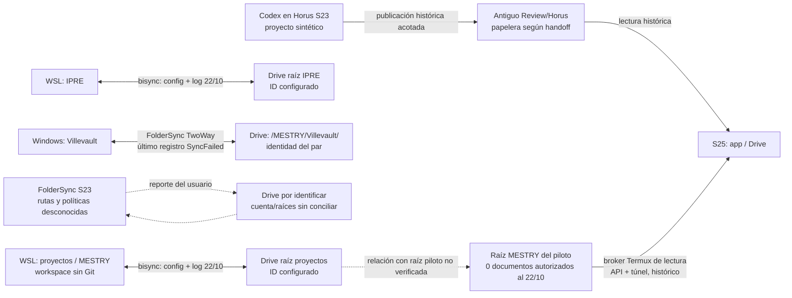
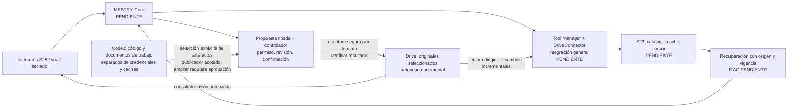

# MESTRY — Infraestructura y sincronización

Fecha: **2026-10-26**, America/Santiago. Estados y alcance epistemológico según [01](01_ESTADO_ACTUAL_MESTRY.md). Evidencias E01–E14 y H01–H06 en [05](05_EVIDENCIAS_Y_PRUEBAS.md). Configuraciones y sincronizaciones no modificadas.

## 1. Topología y autoridades

Hay varios circuitos con identidades y finalidades diferentes. No se ha demostrado que todos usen la misma cuenta o la misma carpeta MESTRY. **La coincidencia de nombre no establece identidad remota:** se deben conservar IDs y conexiones.

| Tipo de material | Ubicación observada/documentada | Autoridad y acceso |
|---|---|---|
| Originales documentales seleccionados | Google Drive; autoridad congelada D-02 | Acceso actual a las raíces históricas no disponible desde el conector de esta sesión |
| Réplica/árbol local Windows | `C:\Users\developer\Villevault\` | Par FolderSync TwoWay: es también un posible escritor, no una réplica inmutable |
| Árbol local WSL | `/home/developer/proyectos`, contiene MESTRY; además `/home/developer/IPRE` | Script rclone bidireccional: ambos lados pueden producir cambios |
| Directorio de esta auditoría/Codex WSL | `/home/developer/proyectos/mestry` | Workspace local legible/escribible; no es un repositorio Git y participa en el árbol configurado para bisync |
| Proyecto Codex S23 | `/workspace/projects/mestry-horus-smoke`, dentro de Horus | Proyecto sintético históricamente verificado; **no se probó que replique este workspace WSL** |
| Fuentes Android/bridge | `~/.cache/mestry/...`, con copia piloto8 identificada en E04 | Código de desarrollo reproducido; no es el corpus de Drive |
| Git | No existe en MESTRY; sí en proyectos vecinos | Los metadatos de los vecinos figuran en listados de sincronización |
| Estado y credenciales S23 | Termux privado; journal y configuración `~/.local/state/mestry-publish` | OAuth histórico separado del UID Horus. No inspeccionado actualmente |
| Estado operativo local | `~/.cache/rclone/bisync`, `~/.local/state/mestry-bisync`, `~/.local/state/mestry` | Listados/logs/instrumentación; no constituyen documentos originales ni índice RAG |
| Índice RAG MESTRY | No localizado | Un journal de publicaciones o caché de chat no es un índice documental |

El árbol principal WSL no es symlink y no se encontraron symlinks internos. No se demostró un enlace, montaje o replicación que haga visibles sus archivos al Codex del S23. E01, E04, E10, H01.

## 2. Galaxy S23 Ultra: última evidencia disponible

**Estado actual: BLOQUEADO / SIN ACCESO.** ADB enumeró cero dispositivos; SSH al alias conservado `mestry-s23` no tuvo ruta a `192.0.2.15:8023`; TCP a `192.0.2.11:8023` agotó el tiempo. No se deduce que el teléfono esté apagado. La IP LAN es una configuración conservada, no una dirección reconfirmada. E07–E08.

| Campo | Observación histórica, con fecha y límites |
|---|---|
| Identidad | SM-S918B / dm3q, S23 Ultra, ABI `arm64-v8a`, ocho CPU lógicas. Identificación por modelo/serial en los paquetes H01/H04 |
| Android | 16 / API 36; build `BP4A.251205.006.S918BXXSAFZI1`, parche 2026-09-05, auditoría del 20/10 |
| One UI / región / arranque | Propiedad One UI `80500`, CSC CHO; Verified Boot green y bootloader/vbmeta locked el 20/10. No se verificó hoy ni se desbloqueó |
| Termux | 0.118.3, procedencia F-Droid; home Android privado `/data/data/com.termux/files/home`, UID 10348 documentado |
| SSH Termux | OpenSSH 10.6p1-2 en inventario inicial; migración permanente a **8023** documentada después. Clave pública obligatoria, contraseña y teclado interactivo deshabilitados en la lectura del 22/10 |
| Boot | Termux:Boot 0.8.1; `.termux/boot/10-mestry-sshd` llama helper `bin/mestry-ssh-start`, que contiene wake lock. Ejecución manual histórica; arranque tras reinicio **PENDIENTE** |
| Debian | Instancia `mestry-debian13`, Debian 13/trixie arm64 mediante PRoot-Distro; helper `~/bin/mestry-debian`; aceptación mínima histórica |
| X11 | Termux:X11 y xterm aceptados históricamente, socket Unix autenticado, TCP deshabilitado; no requisito demostrado de Codex en Horus |
| Horus | 1.0.4, paquete `com.scariflabs.horus`, UID Android 10350; Alpine 3.24.0 aarch64, Python 3.14.8 histórico; perfil SSH `/home/horus` |
| Recursos | El 20/10 el kernel expuso `MemTotal=7.242.340 KiB` (≈6,9068 GiB); no identifica capacidad comercial ni incluye RAM Plus como RAM física. Después de tareas Horus: mediana MemAvailable ≈2,878 GiB; PSS del conjunto observado ≈601,3 MiB; `/data` libre ≈210,99 GiB. Son muestras históricas, no máximos ni capacidad actual |
| Energía/servicios | Al cierre del 22/10 Termux/Horus/Tailscale tenían procesos y servicios foreground; wake locks Termux/Horus presentes; ambos teléfonos por USB al PC. Sin prueba de cargador de pared, PC físicamente apagado o 24 h |

La instalación Debian/X11 y el bloqueo del sandbox de la app Linux oficial son antecedentes distintos de la ruta Horus que el usuario validó. **No se propone reinstalar ni rediseñar Codex.** PRoot no acredita aislamiento del SO; los perfiles guest `/root` y `/home/horus` no deben tratarse como un único home. H01, H04, H05.

## 3. Codex, herramientas y estabilidad

| Aspecto | Evidencia y estado |
|---|---|
| Versión S23 | 0.163.0 vista en TUI y diagnóstico app-server histórico; funcionamiento actual **REPORTADO POR USUARIO** |
| Instalación/ejecutable | Fuente Horus y preflight documentan npm `@openai/codex`, entrada `$HOME/.local/lib/node_modules/@openai/codex/bin/codex.js` y launcher `$HOME/.local/bin/codex` del perfil SSH. Es método/ruta documentados, **no inspección actual del binario**. El antiguo `/usr/local/bin/codex` era stub antes de instalar el perfil y no prueba instalación final |
| Directorio de trabajo | Proyecto sintético `/workspace/projects/mestry-horus-smoke`; no se acreditó acceso al repo WSL ni al corpus FolderSync |
| Configuración general | Piloto actual documentado fuerza/verifica `approvalPolicy=never`, `sandbox=dangerFullAccess`; autenticación ChatGPT histórica; sin transcribir cuenta, tokens ni configuración completa |
| Herramientas del teléfono | Node/Codex y Python usados en tareas verificadas; SSH/Dropbear en perfil remoto. Lista completa y versiones actuales no accesibles |
| Herramientas WSL | Python 3.12.3, Node 22.23.1, Git 2.43.0, rclone 1.75.2, npm, OpenSSH y ADB Windows disponibles; Java/javac no resueltos por `command -v` en el PATH de esta sesión |
| Persistencia | Historial extendido app-server; H02 documenta reapertura sin caché objetivo y recuperación desde servidor. H04 documenta cinco callbacks `session.sync` frescos por celular |
| Recuperación | Watchdog dentro de Horus consulta salud cada 30 s y controla propiedad antes de arrancar; no mata bridge vivo, falla cerrado ante error de controlador. Proceso/UID completo y Boot tras reinicio no ensayados |

Para el circuito remoto documentado se requieren el servicio Android de Horus, su guest/bridge y app-server, SSH Termux y el reenvío ConnectBot en S25; para la ruta privada también Tailscale en ambos dispositivos y red hacia el proveedor de Codex. La consulta Drive requiere el broker Termux y acceso HTTPS/OAuth ya configurado. **El procesamiento local S23 no implica inferencia offline** ni disponibilidad sin Internet.

El bloqueo local de la UI Horus de 15 minutos no equivale por sí solo a terminar SSH. ConnectBot puede conservar una terminal cerrada después de desconectar VPN; seleccionar esa terminal no prueba una conexión nueva. Una clave cifrada puede necesitar desbloqueo humano en ConnectBot. No se garantiza recuperación silenciosa completa. H01, H02, H04.

Puertos históricos: Termux **8023**; Horus SSH **127.0.0.1:8022**; bridge **127.0.0.1:8787**; reenvío S25 **127.0.0.1:18787**. `ws://127.0.0.1:18787` lleva autenticación de aplicación; el transporte entre dispositivos lo protege SSH/Tailscale. No se escanearon ni abrieron estos puertos en los teléfonos durante la auditoría.

## 4. rclone WSL: flujo reconstruido

Se encontró `/home/developer/sincronizar-mestry.sh`; **solo se leyó**. Configuración privada `~/.config/rclone/rclone.conf`, modo **0600**, un remote `gdrive`, backend Drive, scope declarado **`drive`**. Existen campos de credenciales; no se imprimieron sus valores ni se hizo refresh para listar cloud. La cuenta y los scopes efectivos concedidos no se confirmaron con Google. E09.

| Raíz local | Destino por identidad configurada | Evidencia de ejecución |
|---|---|---|
| `/home/developer/IPRE` | `gdrive:` con `--drive-root-folder-id DRIVE_ID_05_EXAMPLE` | Log termina `Bisync successful`, 2026-10-22 13:00:39 local; ejecución de recuperación/resync, cero transferidos al cierre. Un intento previo falló por permiso de lectura de un JAR; se conserva separado |
| `/home/developer/proyectos` | `gdrive:` con `--drive-root-folder-id DRIVE_ID_08_EXAMPLE` | Log termina `Bisync successful`, 2026-10-22 15:22:37 local; 1,374 GiB y 11.459 transferencias informadas |

Los nombres locales **no prueban la ruta padre actual de esos IDs en Drive**. El script los llama IPRE/proyectos; no se verificó su ascendencia remota ni su coincidencia de cuenta con FolderSync.

Política leída y corroborada contra `rclone bisync --help` local:

| Aspecto | Configuración / implicación |
|---|---|
| Dirección | `bisync`, bidireccional; no es corpus read-only |
| Activación | Modos `preview`, `init`, `run`; historial shell contiene preview/init. Sin rclone activo al inspeccionar; sin cron del usuario ni temporizadores MESTRY hallados. No se acredita ejecución periódica |
| Inicialización | `init` usa `--resync`; ayuda local indica preferencia predeterminada por Path1. **No es un comando inocuo de diagnóstico ni debe repetirse para corregir un fallo sin revisar diferencias** |
| Exclusión mutua | `flock -n` sobre `~/.local/state/mestry-bisync/sync.lock`; coordina este script, no todos los clientes/dispositivos |
| Acceso y borrados | `--check-access` exige sentinelas `RCLONE_TEST`; `--max-delete 20` limita número de borrados, no los prohíbe. `--create-empty-src-dirs` también contempla creación/eliminación de directorios vacíos según ayuda |
| Conflictos | `--conflict-resolve none`; ayuda señala tratamiento predeterminado `num` de perdedores/ambas versiones cuando no hay ganador. No equivale a detener todo ni a evitar nombres adicionales |
| Recuperación | `--resilient --recover`; no sustituyen revisión humana de resultados inciertos ni respaldo |
| Comparación | Sin `--compare` explícito; ayuda predeterminada `size,modtime`. Listados inspeccionados no aportan checksums de contenido para MESTRY |
| Filtros | `~/.config/rclone/mestry-bisync.filters`, SHA-256 en E09; excluye node_modules, venv/.venv/venvs, cachés Python, temporales y metadatos; una exclusión específica de plugin IPRE. **No excluye `.git`, build, `.env`, claves o configuraciones por regla general** |

Los dos listados `proyectos` path1/path2 del 22/10 contienen **1.793 archivos MESTRY**. Al compararlos con los 1.803 archivos locales iniciales: cero rutas históricas faltantes localmente, cero diferencias de tamaño entre rutas comunes y diez archivos locales adicionales, todos `.pyc` preexistentes excluidos por filtros. **No se compararon bytes cloud ni hashes actuales**; igual tamaño/listado histórico no implica integridad presente. Los cinco informes nuevos no están cubiertos por esa fotografía ni se han sincronizado mediante esta auditoría. E10.

## 5. FolderSync Desktop Windows

Instalación confirmada: Appx **FoldersyncDesktop 2.13.0.0**, familia `FoldersyncDesktop_6t9j0n6a0fbtj`. También se detectó Google Drive for desktop **132.0.0.0**, sin proceso GoogleDriveFS en la consulta. No se acreditó un flujo activo de este último. No se observó proceso cuyo ejecutable perteneciera al paquete FolderSync en la consulta específica. E11–E12.

Base inspeccionada de forma selectiva:

`C:\Users\developer\AppData\Local\Packages\FoldersyncDesktop_6t9j0n6a0fbtj\LocalCache\Local\FolderSync\database\foldersync.db`

DB de 83.734.528 bytes, con WAL y SHM presentes. Se consultó **`mode=ro&immutable=1`**; no se copiaron DB, cuentas, cookies ni credenciales. No se forzó checkpoint ni se garantiza incorporar todo WAL pendiente. La descripción siguiente corresponde a las filas persistidas leídas. El log de escritorio tiene 31.830.514 bytes y mtime 2026-10-23 23:22:49 local; no se volcó su contenido completo.

| Parámetro del único par v2 | Valor observado |
|---|---|
| Origen | `C:\Users\developer\Villevault\`, directorio sin reparse link en su raíz |
| Destino | GoogleDrive, ID `DRIVE_ID_07_EXAMPLE`, ruta mostrada `/MESTRY/Villevault/` |
| Habilitado / dirección / estado | Sí / `TwoWay` / `SyncFailed` |
| Eliminaciones / papelera | `syncDeletionEnabled=0`, `syncUseRecycleBin=1`; no se ensayó su efecto real |
| Sobrescritura / conflicto | `IfNewer` / `Skip`; configuración, no una prueba de protección concurrente |
| Checksums | `syncDisableChecksumCalculation=1`; comprobación de tamaño no deshabilitada |
| Otros modos | Sin move, backup, monitor local ni temporales de transferencia habilitados; `remoteChangesCheckEnabled=1` |
| Cifrado de contenido del par | `encryptionMode=None`; no determina cómo se protegen tokens o cómo cifra Drive su almacenamiento |
| Filtros | Cero filas en `v2_folderpair_filters`; no hay exclusiones del par acreditadas |
| Programación | Tres schedules habilitados: uno `0 12 * * *`, dos con cron vacío. No se infiere el disparador de los vacíos. Wi-Fi requerido en las filas; sin VPN/carga obligatorias. Sin tarea equivalente entre 236 tareas Windows consultadas: la programación puede pertenecer a la app |
| Conexiones | Una LocalStorage y una GoogleDrive con `loginValidated=1`; no se extrajo identidad de cuenta ni material de autenticación |

Historial observado:

| ID | Inicio local | Fin local | Resultado | Contexto |
|---|---|---|---|---|
| 1 | 21/10 18:05:17 | 21/10 18:11:17 | `SyncCancelled` | Origen User |
| 2 | 21/10 18:11:28 | 22/10 16:49:31 | `SyncFailed` | 131.649 archivos comprobados; 131.643 eventos TransferFile, 12.239 CreatedFolder y seis TransferError |
| 3 | 22/10 16:49:34 | 22/10 18:00:41 | `SyncFailed` | ScheduledSync; texto de error no copiado; clasificación por términos sugiere permiso/cuota, sin causa final adjudicada |
| 4 | 22/10 18:00:41 | 23/10 01:03:21 | `SyncFailed` | ScheduledSync; último fin coincide con `syncLastRun` del par |

Los eventos TransferFile del registro 2 suman **11.789.247.602 bytes**. Esto acredita actividad registrada, **no un resultado completo correcto**. Hay 143.882 filas de estado de archivos; los patrones inspeccionados encuentran 97.320 claves con `/node_modules/`, 10.482 con `/build/` y 2.637 con `.git/`. Estos conteos son por coincidencia de ruta, pueden solaparse y no se suman como archivos únicos. No se encontraron coincidencias de las clases `.env`, `rclone.conf`, `id_ed25519` o `.keystore` buscadas; la búsqueda acotada no certifica ausencia de todo secreto.

## 6. Tabla de flujos y diagramas

| Origen | Destino | Herramienta | Dirección | Estado | Evidencia | Riesgo |
|---|---|---|---|---|---|---|
| WSL `/home/developer/proyectos` | Raíz Drive ID `1rWk...PPZU` | rclone bisync | Bidireccional | **CONFIGURADO / NO VERIFICADO** hoy; éxito histórico 22/10 | E09–E10 | Borrados/cambios, `.git` y build; sin scheduler confirmado |
| WSL `/home/developer/IPRE` | Raíz Drive ID `1A_IV...UVC` | rclone bisync | Bidireccional | **CONFIGURADO / NO VERIFICADO** hoy; recuperación histórica | E09 | Árbol ajeno a MESTRY y fallos por permisos/symlinks; no modificarlo desde esta auditoría |
| Windows Villevault | `/MESTRY/Villevault/`, ID `1OPv...eirx` | FolderSync Desktop | Bidireccional | **CONFIGURADO / NO VERIFICADO**, último registro fallido | E11–E12 | Sin filtros; cuota/errores pendientes; duplicación de dependencias |
| S23, ruta desconocida | Drive, raíz/conexión desconocidas | FolderSync Android | Desconocida | **REPORTADO POR USUARIO**; configuración **BLOQUEADA / SIN ACCESO** | Solicitud del usuario, E07–E08 | No se conocen borrados, conflictos, permisos o solapamientos |
| Google Drive | Navegador S25 por broker S23 | `mestry-drive-v1`, SSH/bridge/app | Lectura Drive→S23→S25 | **IMPLEMENTADO Y VERIFICADO**, histórico para raíz/controles | H03, E05–E06 | Grant por archivo; raíz vacía para cliente; sin caché/indexación general |
| Codex/Horus, fixture seleccionado | Antiguo Review/Horus | Publicador Python + SSH forzado | S23→Drive→revisión S25 | **IMPLEMENTADO Y VERIFICADO**, histórico; destino posterior en papelera | H02, H06 | Escritor conserva destino antiguo y allowlist de prueba |
| Drive | S25, descarga/réplica local general | No identificado | Desconocida | **BLOQUEADO / SIN ACCESO** | H03–H04, E07 | Abrir un archivo por app/API no prueba una réplica local sincronizada |
| Windows | Drive | Google Drive for desktop instalado | Desconocida | **CONFIGURADO / NO VERIFICADO** | E11 | No se inspeccionó un par activo ni solapamiento con FolderSync |

Flujo observado/configurado. Las líneas discontinuas representan relaciones reportadas o sin trazado completo; ninguna flecha afirma transferencia actual el 26/10.

Flujo objetivo de los **principios congelados D-02–D-15**. Los módulos aún pendientes se rotulan como tales. No supone aprobación de librerías, WorkManager, nuevo servidor o un segundo índice S25.

Diferencias: los sincronizadores externos actuales trabajan por árboles y no demuestran identidad/versionado/ACL de MESTRY Core; el navegador implementa lectura directa acotada, pero no catálogo incremental ni RAG; el escritor no edita documentos generales; Windows/WSL sigue participando en desarrollo y réplicas; no hay aceptación física de operación independiente del PC. Los tres destinos configurados no tienen el mismo ID; **no se confirmó un par duplicado exacto sobre la misma carpeta remota**, pero tampoco se pudieron excluir solapamientos por ascendencia o el par desconocido del S23.

## 7. Acceso de Codex y propagación documental

El Codex que realiza esta auditoría puede leer el workspace WSL; la creación de los cinco informes demuestra escritura autorizada en ese directorio local. Por estar bajo `proyectos`, sus modificaciones **pueden entrar en una ejecución futura del script bisync**, salvo exclusión aplicable. No se ejecutó el script ni se declaró subida completada.

En S23, el broker entrega bytes/metadatos mediante catálogo limitado y mantiene OAuth en otro UID. El proyecto sintético tiene acceso histórico a sus fixtures; **no se verificó que Codex abra directamente los directorios FolderSync ni que existan copias independientes o symlinks hacia almacenamiento compartido**. Autorizar una carpeta en la app no concede automáticamente el mismo grant a todos sus descendientes ni sincroniza el workspace. H01, H03.

Rutas Android de almacenamiento compartido, grants SAF, persistencia de URI y permiso efectivo de escritura quedan **BLOQUEADOS / SIN ACCESO**. No se equipara `/storage/emulated/0` a un filesystem POSIX apto para Git ni se afirma que ya exista allí un checkout. Los permisos 0755 del workspace WSL indican permisos POSIX, no validan acceso Android o ACL remotas.

Riesgos operativos sin resolver: modificaciones concurrentes, dos clientes sobre un documento, borrados propagados por bisync, carpetas remotas con el mismo nombre pero distinto ID, ausencia de versión remota en una réplica local, cuotas por copiar dependencias y falta de evidencia de backup independiente. Una sincronización bidireccional no es por sí misma un respaldo recuperable.

## 8. Verificaciones pendientes y recomendaciones sin aplicar

1. Leer pares FolderSync S23 con dispositivo identificado, exportando solo rutas/modos/filtros/último resultado; no exportar cuentas o secretos. Identificar su relación por ID con los tres destinos descubiertos.
2. Conciliar conexiones de Drive de forma privada, sin alternar cuentas ni ampliar scopes para resolver el 404. Comparar identidad y permisos efectivos sin guardar correos/tokens.
3. Revisar la causa del último fallo Windows y el tratamiento de WAL/logs en una sesión de lectura de la app. No aceptar 131.643 eventos de transferencia como éxito global.
4. Acordar qué carpetas son originales, réplicas, código y temporales. Presentar un diff de exclusiones/retención antes de cualquier cambio de sincronizador.
5. Aceptar lectura de un archivo explícitamente autorizado desde S25 vía broker S23, con ID, bytes y versión/origen; no hace falta publicar nada para este primer incremento.

**Pruebas de escritura futuras: no autorizadas ni ejecutadas aquí.** Si se necesitan, el procedimiento debe aprobar destino exacto fuera de originales, un archivo temporal de nombre único, datos sintéticos, autor de cada cambio, hashes antes/después y política de limpieza. Probar primero lectura/versiones; después un solo escritor; después edición concurrente y eliminación controlada en un área de prueba. No usar archivos importantes, no activar un sincronizador para «ver qué pasa» y no ejecutar `init`/`--resync` como sonda. Los ensayos de reinicio, fallo de UID y PC apagado tienen protocolos/aprobaciones separados en [04](04_PLAN_DE_CONTINUIDAD.md).
