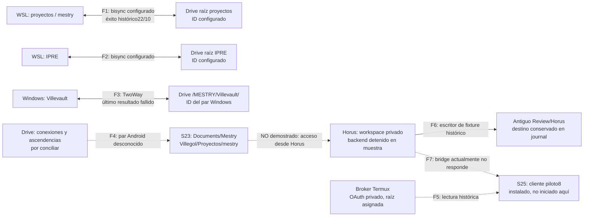

# MESTRY — Mapa de sincronización real

Fecha: **2026-10-26**, segunda inspección desde 20:32 −03:00. Lectura únicamente. Evidencia L03/L06–L09 de [07](07_EVIDENCIAS_Y_LIMITACIONES.md). Este mapa separa **datos observados**, configuración persistida, ejecuciones históricas y relaciones desconocidas.

## 1. Circuitos encontrados

| ID | Origen/destino local | Contraparte remota | Herramienta/dirección | Activación y filtros | Resultado observado y riesgo |
|---|---|---|---|---|---|
| F1 | WSL `/home/developer/proyectos` | Drive ID `DRIVE_ID_08_EXAMPLE` | rclone bisync, dos vías | Script manual preview/init/run; filtros conocidos; sin cron del usuario | Último log exitoso22/10 15:22:37. Árbol incluye repos vecinos/build; no prueba cloud actual |
| F2 | WSL `/home/developer/IPRE` | Drive ID `DRIVE_ID_05_EXAMPLE` | rclone bisync, dos vías | Mismo script/lock/filtros; se ejecuta antes que proyectos | Último éxito 22/10 13:00:39 tras fallo previo. No reejecutar resync ni tocar este proyecto ajeno |
| F3 | Windows `C:\Users\developer\Villevault\` | Drive ID `DRIVE_ID_07_EXAMPLE`, ruta mostrada `/MESTRY/Villevault/` | FolderSync Desktop 2.13.0.0, TwoWay | Tres schedules habilitados: `0 12 * * *` y dos cron vacíos; cero filtros | DB sigue SyncFailed; una cancelación/tres fallos; datos operativos/dependencias incluidos |
| F4 | S23 `/storage/emulated/0/Documents/Mestry` accesible mediante SAF; ramas Villevault y Villegol/IPRE/Proyectos | **IDs/cuenta/par remoto desconocidos** | FolderSync4.14.0 presente; dirección desconocida | Grant SAF persistente read/write y permiso general UID; pares/filtros/horarios privados sin acceso | Hay copia de MESTRY con ADR idéntico por SHA; no prueba que F1/F3 sean su contraparte ni que esté al día |
| F5 | S23 Horus `/workspace/projects/mestry-horus-smoke` | Navegador S25 mediante bridge y broker Termux, raíz Drive `DRIVE_FOLDER_02_EXAMPLE` | Lectura API acotada, no réplica de workspace | Bajo demanda del cliente; configuración raíz/assignment actual conserva IDs | Funcionó históricamente; bridge ahora sin respuesta. No indexación incremental/RAG |
| F6 | Fixture Codex en Horus | Journal Termux con destino `DRIVE_FOLDER_01_EXAMPLE` | Publicador por clave SSH restringida, S23→Drive | Manual por herramienta, un documento/64KiB; versiones separadas | Dos revisiones históricas; destino posterior en papelera, no redirigido. No es backup general |
| F7 | S23↔S25/Windows | Tailscale, Termux8023, Horus loopback8022, bridge8787, reenvío S25 18787 | Acceso remoto, **no sincronización física** | Cliente/SSH; VPN S25 automática histórica | S23 Termux activo; Horus remoto detenido; S25 cliente instalado sin proceso observado |
| F8 | Windows | Google Drive for desktop instalado según línea base | Flujo no identificado | Sin configuración activa inspeccionada | No asignar rutas ni declarar solapamiento sin evidencia |

Cuenta/conexión se representan por alias de herramienta e IDs. No se imprimieron identidades de cuentas ni credenciales. Los **4,8TB libres de Drive son REPORTADO POR USUARIO**, no medición nueva; no justifican perder semántica de archivos o consistencia.

## 2. Diagrama observado

Las flechas sólidas indican configuración/evidencia de transferencia histórica, **no actividad actual**. Las discontinuas son relaciones incompletas o una capacidad que hoy no está operativa. No se ha probado por metadata cloud que las raíces F1/F2 sean hijas de la misma MESTRY del broker ni que F3/F4 sean el mismo par por ID. El nombre compartido Villevault no resuelve esa identidad.

## 3. Políticas efectivas leídas

### rclone WSL

Script `/home/developer/sincronizar-mestry.sh`, no ejecutado. Remote `gdrive`, backend Drive, scope configurado `drive`, archivo privado0600. El runtime Termux del piloto usa por separado `drive.file`; no se intercambiaron tokens.

Flags observados: `--check-access`, `--max-delete 20`, `--conflict-resolve none`, `--resilient`, `--recover`, `--create-empty-src-dirs`, archivo de filtros y logs separados; `flock` local contra dos ejecuciones del mismo script. `init` añade `--resync`; `preview` además dry-run. **No se ejecutaron ni siquiera para diagnóstico.**

Errata importante: **bisync interpreta20 como porcentaje**. El [código1.75.2](https://raw.githubusercontent.com/rclone/rclone/v1.75.2/cmd/bisync/deltas.go) compara la fracción borrada contra `MaxDelete/100`. La [documentación específica](https://rclone.org/bisync/#--max-delete) coincide. La ayuda heredada genérica del comando llevó al informe anterior a describirlo como número de borrados: esa interpretación queda corregida aquí. No se calcula cuántos archivos podría borrar una ejecución real sin sus listados/deltas actuales.

`conflict-resolve none` no equivale a veto total de toda operación: los conflictos tienen su tratamiento/nombres de conservación. `recover` no hace backup ni valida un merge semántico. El lock local no coordina FolderSync, editores Windows o Codex.

Filtros excluyen node_modules, venv/.venv/venvs, caches Python, temporales y metadatos de SO; no contienen exclusión general `.git`, build o secretos. El último listado histórico de proyectos contiene5.066 entradas con `/.git/` y5.655 con `/build/`. Son conteos del 22/10, no inventario cloud nuevo. Excluir dependencias de este intercambio **no implica borrarlas del S23**; su conservación/reconstrucción se diseña por plataforma en [03](03_PORTABILIDAD_Y_PERSISTENCIA.md).

### FolderSync Desktop

Imagen SQLite leída `mode=ro&immutable=1`; DB/WAL/SHM sin copiar ni checkpoint. El par sigue habilitado TwoWay, reemplazo `IfNewer`, conflicto `Skip`, borrados deshabilitados, papelera habilitada y cálculo checksum deshabilitado. No hay filtros v2. Los cron vacíos no se reinterpretan como horarios conocidos.

Historial de cuatro registros: cancelación 21/10; fallos con cierres 22/10 16:49,22/10 18:00 y 23/10 01:03 local. No hay éxito final observado. La ejecución con transferencias registra131.643 TransferFile, seis TransferError y11.789.247.602 bytes: **transferencias registradas no equivalen a éxito integral**. La lectura no acredita incorporar todos los frames WAL pendientes.

### FolderSync S23 y límites de acceso

`dk.tacit.android.foldersync.lite`,4.14.0; grant persistido `content://com.android.externalstorage.documents/tree/primary%3ADocuments%2FMestry`, modos lectura/escritura. La DB privada no es legible por ADB shell; no había backup exportado encontrado en los directorios externos de app inspeccionados. No se navegó la UI ni se activó exportación, debug, CLI o sincronización.

Se verificó la copia compartida del ADR en `Villegol/Proyectos/mestry`, con el mismo hash WSL. Se compararon también pins/parche cuando la consulta terminó; ver L07. Esto no resuelve modo, periodicidad, conflicto o propagación de borrados del par Android. No se copiaron documentos para completar la prueba.

## 4. ¿Puede FolderSync sincronizar el workspace Codex?

**Por acceso directo a archivos: no está acreditado y la frontera actual lo impide por defecto.** El workspace está bajo datos privados UID 10350; FolderSync tiene UID 10353. Su permiso general no concede acceso a datos privados de otra app, según [Android](https://developer.android.com/training/data-storage/manage-all-files). Un symlink no concede permisos ni añade binds PRoot; no se propone como solución.

| Vía | Viabilidad y límite | Decisión propuesta |
|---|---|---|
| Compartir `/workspace` por symlink hacia Documents/Mestry | Sin prueba, sin grant/bind Horus; además cambia semántica POSIX del workspace | No adoptar |
| Directorio de intercambio compartido | Viable solo con export/import del UID dueño y permisos Android compatibles; usar paquetes completos con hashes, nunca checkout vivo | Reserva para entregas seleccionadas; no modificar Horus para lograrlo ahora |
| FolderSync→SFTP Horus por loopback | Protocolo SFTP oficialmente soportado; requeriría servicio activo, cuenta/clave permitidas y par nuevo. La conexión no evita inconsistencia al copiar archivos abiertos | Alternativa para **exports cerrados**, no fuente de verdad de `.codex`/`.git` vivos. Requiere aprobación y prueba |
| SSH/SFTP Windows→Horus por Termux | Reutiliza puertos; no existe acceso WSL al perfil privado autorizado/probado actualmente | Proponer identidad dedicada y alcance mínimo; no reutilizar/extraer clave privada S25 |
| rsync | WSL tiene cliente; Termux no lo resuelve y Horus actual sin inventario | Condicional a ambos extremos, POSIX y exclusión de datos activos; no instalar ahora |
| Git por SSH o bundles | Intercambia objetos/refs verificables, sin replicar `.git` por carpetas | Preferido para fuente/configuración portable, después de crear una línea base autorizada |
| rclone dentro del UID adecuado | No encontrado en Termux; en Horus sin verificar. OAuth junto a Codex ampliaría exposición | No instalar como atajo ni copiar rclone.conf al workspace; mantener separación documental |
| Publicación controlada de paquetes | Extender el mecanismo acotado existente a bundles/exports y recibos, con límite/destino aprobados | Vía propuesta de backup/offline; el publicador actual de64KiB no la implementa |

Soporte de [protocolos FolderSync](https://foldersync.io/docs/help/supportedservices/) y [rsync](https://download.samba.org/pub/rsync/rsync.1) se consultó documentalmente; no se probaron nuevos pares o conexiones.

## 5. Qué conservar y qué revisar

Conservar la instalación Codex/Horus, cliente S25, separación de UIDs/OAuth y puertos actuales. **FolderSync puede conservar el circuito documental** una vez conocidos/corregidos sus pares; no se necesita sustituirlo para introducir Git/handoff del desarrollo.

Revisar los árboles completos WSL/Windows y el par Android antes de cambiar exclusiones. No modificar filtros sobre una base bisync previa sin protocolo de reconciliación: el cambio de universo puede alterar qué se considera eliminado. Preparar diff/dry-run autorizado, backup y aceptación; no resync automático.

Los documentos Drive permanecen autoritativos; código y estado operativo requieren mecanismos distintos. El flujo propuesto no exige mover los originales a Git ni conservar el backend en Windows. Los diagramas objetivo y automatización por sesión están en [05](05_ARQUITECTURA_RECOMENDADA.md).
