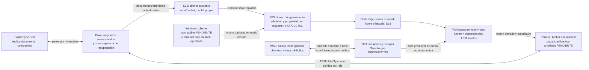

# MESTRY — Arquitectura recomendada para continuidad

Fecha: **2026-10-26**. **PROPUESTA D**, pendiente de aprobación/implementación. Conserva Codex/Horus y cliente S25. No se ha creado Git, coordinador, cliente Windows, backup o automatización nuevos. La [comparación](04_COMPARACION_ARQUITECTURAS.md) explica por qué se elige frente a A/B/C.

## 1. Decisión recomendada

**S23 es el nodo operativo principal; el acceso remoto es el modo habitual. WSL es un ejecutor local opcional con checkout y dependencias propios. Las entregas entre ambos se hacen por versiones verificadas, con propietario de edición y handoff. Drive conserva los originales documentales y copias de recuperación/artefactos, no las bases activas del entorno.**

El usuario puede abrir el mismo proyecto/hilo desde otra interfaz sin transferirlo si sigue usando el S23. Cuando elige Codex local WSL, inicia otra ejecución y conserva continuidad **del trabajo confirmado**, con contexto explícito; no una tarea viva trasladada.

## 2. Distribución y autoridad

| Estado/componente | Autoridad propuesta | Réplicas/acceso y regla |
|---|---|---|
| Fuente, configuración portable, locks y handoff técnico | Git por proyecto; referencia aceptada en S23 | WSL con clon independiente. Solo archivos que no sean originales Drive administrados por ese circuito |
| Ediciones todavía no entregadas | Host/branch que las produjo | Nunca borrarlas porque la otra máquina tiene una versión más reciente; branch de rescate y recibo pendiente |
| Originales documentales seleccionados | **Drive, APROBADO / CONGELADO D-02** | FolderSync/broker son réplicas/acceso; controlar revisión antes de escribir |
| Documentos técnicos del repositorio | Git si se clasifican como fuente del proyecto | Publicación revisable Drive por versión; no convertir simultáneamente el mismo archivo en dos originales editables |
| Dataset/resultados/artefactos únicos | Manifiesto por hash/ID y almacenamiento autorizado | Transferencia cerrada y backup; no asumir que Git incluye archivos ignorados/LFS/submódulos externos |
| Dependencias/toolchains | Instalación local de cada target | Cápsula versionada de recuperación por SO/CPU/libc/runtime; no copiar venv/node_modules del PC sobre S23 |
| Hilos y estado Codex S23 | Home efectivo del backend S23 | Clientes consultan esa autoridad; backup coherente separado, sin fusión con el home WSL |
| Hilos y estado Codex WSL | CODEX_HOME del PC | Se conserva localmente; entrega un handoff explícito, no su DB activa |
| Propietario/época/recibos de entrega | Coordinador lógico único en S23 | Registro durable privado; no se replica como archivo mutable por Drive |
| OAuth Drive | UID Termux existente | Codex/cliente no reciben tokens. Ampliar operaciones no significa ampliar scopes automáticamente |
| Identidades de clientes | Almacén privado de cada cliente | Windows necesita provisión propia aprobada; no extraer pairing/Keystore S25 |
| Monitorización | Salud por capas del S23; vista bajo demanda S25/PC | Sin nuevo servicio externo permanente por defecto; sin prometer alerta si todo el nodo muere |

**No hay autoridad única para todos los bytes.** Debe clasificarse cada ruta antes de asignarla a Git o a originales Drive; las proyecciones/versiones publicadas tienen IDs diferentes y se presentan como tales.

## 3. Diagrama objetivo — todo lo nuevo está propuesto

No requiere nuevo puerto, servidor cloud, NAS, motor vectorial ni backend S25. Git bare es almacenamiento servido por SSH existente cuando se autorice; el coordinador es lógica del bridge/helper del dueño. Requiere código y pruebas, no se afirma ya instalado.

## 4. Ubicaciones y acceso

Mantener intacto el proyecto actual de prueba. Para proyectos futuros, raíz operativa privada bajo `/workspace/projects/<project_id>` en Horus y repositorios/registro de entregas bajo home privado aprobado. El workspace físico sigue dentro de `filesDir/horus/workspaces/default`; no se traslada al árbol FolderSync.

En WSL, elegir un checkout duradero fuera de los árboles bisync amplios, por ejemplo `/home/developer/mestry-workspaces/<project_id>`, **sin crearlo ahora**. Para el código MESTRY existente, preparar una copia/base revisada conservando originales y cachés; no mover ni borrar el árbol actual automáticamente. Alternativamente aprobar exclusiones de sincronización antes de introducir `.git` en su ubicación actual. `.gitignore` no filtra FolderSync/rclone.

Windows remoto necesita acceso al mismo servicio/sesión, no otro Codex lanzado sobre archivos parecidos. La app S25 usa protocolo MESTRY con `X-Bridge-Token`; app-server está detrás por stdio. Un cliente Windows compatible y su autorización propia están **PENDIENTES**. No se propone abrir el bridge a LAN o usar un navegador contra endpoints que hoy rechazan Origin.

Implementación preferida de ese cliente: un cliente ligero Windows/WSL usa SSH hacia un **helper de catálogo dentro del perfil Horus**, autorizado por una identidad propia; el helper conecta al bridge existente y transmite estados/eventos por stdio. La clave bridge se usa solo dentro de Horus y no se exporta a Windows. El helper limita lectura/control a sesiones/proyectos permitidos y aplica propietario/época para escribir. Se reutilizan8023/8022, sin listener nuevo. Es código y autorización pendientes, no una capacidad actual del SSH Termux ni un proxy ya instalado. Si se desea una shell general aparte, su alcance debe aprobarse por separado.

La documentación oficial ofrece interfaces remotas nativas, pero el transporte/protocolo y versión deben validarse antes de adoptarlos; no son intercambiables con el wrapper MESTRY. App-server/WS tiene advertencias de estabilidad experimental, por lo que el piloto necesita versionado y recuperación propios, no una promesa de SLA. [OpenAI](https://learn.chatgpt.com/docs/app-server). SSH a Termux no concede acceso al UID Horus: autorizar ese acceso desde Windows requiere identidad específica y alcance aprobado, sin copiar la clave privada S25 ni saltarse la frontera actual durante investigación.

## 5. Control de edición y versión confirmada

Protocolo propuesto por proyecto: `owner`, `epoch`, `base_commit`, `accepted_commit`, `operation_id`, estado de entrega, turnos/trabajos pendientes y recibos de validación/backup. La época es un número durable creciente para rechazar clientes antiguos; no una contraseña. El coordinador autentica al cliente y serializa admisión. Registro privado transaccional o journal+lock/fsync a validar en el runtime; no DB replicada por carpeta.

1. Antes de ceder al PC, bloquear nuevas tareas escritoras del proyecto y esperar terminación normal de las existentes. No matar procesos para obtener una falsa quiescencia. Inventariar trabajos de fondo y cambios sin commit.
2. Registrar grant de edición PC con época/base. S23 puede atender lecturas y otros proyectos según política; **no editar ese mismo checkout** por otra ruta gestionada.
3. PC publica commit candidato y manifiesto contra esa base. S23 recibe en repositorio/área de preparación, valida hashes, autorización y que la época/base sigan vigentes.
4. La aceptación de referencia utiliza comparación con valor anterior; si cambió, rechazar o conservar branch de rescate. [Git update-ref](https://git-scm.com/docs/git-update-ref) proporciona actualización condicionada de ref; **no sustituye el control de herramientas/tareas**.
5. Preparar dependencias/árbol por target y validar sin sobrescribir lo activo. Promover solo sin tareas usando la generación anterior. No cambiar un symlink/release por debajo de un proceso que sigue ejecutando código.
6. Persistir recibos y liberar propietario únicamente cuando el resultado se reconcilió. Un timeout posterior al envío produce **UNKNOWN**, no repetición ciega.

Límite material: `never/dangerFullAccess` permite a herramientas del agente o shells del mismo UID eludir un lock cooperativo. La ACL del bridge no confina el SO. La garantía ofrecida es para **flujos gestionados**, con detección de divergencia y no promoción sobre trabajo activo. No hay exclusión fuerte contra procesos no cooperantes en el mismo UID. Si se exige esa garantía, se necesita aprobación de un ejecutor restringido/separación real; no se afirma que PRoot o un archivo lock la proporcionen.

Estados propuestos de una entrega:

| Nivel | Significado y evidencia mínima |
|---|---|
| D0 Guardado local | Bytes en el PC; puede haber buffers no guardados fuera del alcance |
| D1 Versionado local | Commit/manifiesto local; todavía no disponible en S23 |
| D2 Recibido S23 | Objetos/adjuntos íntegros recibidos y recibo durable del servidor |
| D3 Listo S23 | Versión aceptada, dependencias del target comprobadas y proyecto ejecutable según su contrato |
| D4 Recuperable fuera del nodo | Bundle/archivos únicos/cápsulas referenciadas con copia independiente verificada; restauración del formato aceptada |

**Handoff confirmado** requiere D3 y D4, más liberación/reconciliación del control. Si falta backup, mostrar «listo en S23, respaldo pendiente»; si solo pasó WSL, «recibido, ejecución S23 pendiente». No ocultar estados intermedios detrás de un éxito global. Un usuario puede elegir otro riesgo explícito, pero no se asume ese consentimiento.

## 6. Automatización por sesión Windows

Se propone una acción explícita **Abrir trabajo local** y otra **Entregar y cerrar**, con scripts del proyecto y estado visible. No depender exclusivamente del evento de apagado Windows: puede no ejecutarse o quedarse sin red/tiempo. Hooks Git pueden validar, pero no son la única defensa ni una garantía ante herramientas externas. Los nombres de scripts/comandos de [06](06_PLAN_IMPLEMENTACION_Y_PRUEBAS.md) son **futuros**, no herramientas existentes.

### Inicio

1. Comprobar identidad/red/SSH S23 y salud del coordinador/versión; distinguir fallo de transporte de backend detenido. No iniciar servicios automáticamente para ocultar un fallo de preflight.
2. Revisar estado local: cambios guardados/no guardados conocidos, Git dirty, archivos únicos pendientes y entregas UNKNOWN. No auto-stash, limpiar ni resetear.
3. Solicitar snapshot de referencia aceptada y turno/trabajos activos; obtener grant de propietario/época cuando el proyecto quede libre. Si no queda libre, ofrecer observar remotamente o trabajar en una rama offline **sin publicación autorizada**.
4. Obtener objetos Git y archivos externos por manifiesto; verificar base, hashes, rutas y alcance. Detectar divergencia antes de cambiar el working tree.
5. Preparar/verificar dependencias WSL según perfil, en área aislada si cambian. No reinstalar dependencias por cada apertura si las existentes ya satisfacen la huella y pruebas.
6. Registrar que PC está listo para editar y el nivel de confirmación de la base. Si un paso falla, no mostrar «listo» ni cambiar propietario de forma ambigua.

### Durante

Windows trabaja localmente sin sincronización masiva continua. El propietario limita nuevas tareas escritoras S23 sobre ese proyecto. Jobs prolongados se ejecutan sobre una generación fijada; ningún import actualiza sus archivos/dependencias en caliente. Otros proyectos pueden operar según política gestionada y límites del UID descritos arriba.

Checkpoints locales conservan avances entre inicio/cierre. Un commit local no es copia remota. Si el usuario requiere menos riesgo frente a pérdida física del PC durante la sesión, deberá aprobar checkpoints remotos/eventos de commit o un RPO concreto; eso no exige sincronizar continuamente todo node_modules/venv.

### Cierre

1. Guardar archivos y terminar herramientas escritoras; inventariar untracked/resultados/DB que deben exportarse. Registrar pruebas reales, sin inferir éxito de un exit code de transferencia.
2. Crear commit y manifiesto/handoff con base/época/operación. Conservar los cambios locales hasta confirmación final.
3. Reconsultar control/versión S23; ante divergencia o grant viejo, rechazar promoción y conservar una rama de rescate.
4. Transferir objetos/adjuntos a staging; validar hashes y cierre del conjunto. Reintentar solo tras reconciliar el mismo operation_id.
5. S23 prepara y valida el entorno permitido; distingue D2 de D3. Publicar referencia aceptada sin sustituir un checkout ocupado.
6. Verificar la copia independiente y registrar D4; devolver recibo durable. PC comprueba que el servidor aceptó exactamente el commit/manifiesto esperado.
7. Liberar el control y anunciar «entrega confirmada» solo según ese recibo. Si la respuesta se pierde, consultar por operation_id, no publicar otra versión por nombre parecido.

Si Windows se apaga antes del cierre, su disco/branch conserva lo que llegó a guardarse; lo no enviado no puede aparecer en el S23. Este sigue sirviendo la última versión confirmada. No liberar la propiedad automáticamente por timeout: podría volver un PC antiguo. Recuperar con revisión y nueva época, dejando su eventual entrega tardía como propuesta rechazada/rescatable.

Si S23 está desconectado al inicio, permitir trabajo offline explícito sobre la última base conocida; no declarar exclusividad ni confirmación remota. Al volver, reconciliar antes de publicar. Si el S23 reinicia, recuperar el journal y consultar tareas/operaciones inciertas; no repetir turnos/comandos de efecto externo de manera automática.

## 7. Backup completo sin trasplantar dependencias

Conservar una copia operativa local y recuperación independiente. Backup propuesto:

- **Fuente/entrega:** bundle Git y manifiesto de archivos únicos, con hash, commit, operation_id y resultado por plataforma. Incluir explícitamente recursos LFS/submódulos/datos fuera de Git que el proyecto necesite.
- **Ejecución:** cápsulas por plataforma con dependencias, paquetes privados/autorizados, toolchain y configuración no secreta. Una cápsula ya respaldada puede referenciarse desde muchas entregas; no volver a subir gigabytes sin cambio.
- **Estado único:** export de DB del motor y backup Codex/bridge coherente bajo el UID dueño. Al no haberse establecido una exportación oficial general de Codex para migrar instalaciones, validar cualquier backup frío/coherente en la misma versión/perfil antes de confiar en él. No copiar DB/JSONL activos ni auth por carpeta.
- **Credenciales:** procedimiento independiente, cifrado y autorización expresa si se respalda material exportable; preferir reautorización cuando corresponda. No asumir que Keystore se restaura junto con un archivo cifrado.

Drive almacena **artefactos cerrados**, no un filesystem POSIX compartido. En un archivo tar los permisos/enlaces quedan representados internamente; su restore debe remapear propietarios/rutas con criterio del target y probar ejecución. Sin original local/independiente y restauración comprobada, una copia sincronizada no es backup aceptado.

Para operar con PC apagado hace falta un camino S23→Drive propio. El publicador actual solo permite un fixture/64KiB y destino antiguo; **no cubre ese requisito**. Propuesta mínima: ampliar el broker Termux existente con una capacidad específica de backup, destino fijo aprobado, límites, streaming, reserva/journal de IDs, recibos y lectura de verificación. Para cápsulas grandes evaluar subida reanudable antes de habilitarlas; no entregar OAuth a Horus. Alternativa si el coste de ese código no se justifica: aprobar rclone nativo en Termux con perfil privado y permisos limitados, ensayando su integración de credenciales. No se instala ni se elige una cuenta/token nueva en esta investigación.

El primer incremento puede respaldar un bundle pequeño mediante el rclone **ya existente en WSL**, mientras el PC participa en el ensayo autorizado. Así se prueba D4 del laboratorio sin depender de que I3 esté implementado. Eso **no acredita backup autónomo del S23 con PC apagado**: I3 debe aceptar su propio camino y las cápsulas/estado necesarios. El destino lógico `Recovery` sería **nuevo y por aprobar**, no un ID supuesto ni restauración de Review/Horus. Retención, borrado y cifrado requieren política explícita; rclone copy tampoco impide sobrescritura por sí solo.

## 8. Operación permanente y límite tras reinicio

Cadena que debe verificarse: Android/desbloqueo → Termux/SSH/Tailscale → servicio Horus/guest → bridge → app-server → proyecto/dependencias → cliente autorizado. Tener VPN/SSH no significa tener Codex disponible; la observación actual demuestra esa diferencia.

Conservar el watchdog existente y su fallo cerrado: supervisa el bridge **mientras Horus/UID vive**, no resucita la app Android después de una parada completa. Termux:Boot prepara SSH/wake lock, pero no tiene por sí solo permiso de controlar el provider Horus, limitado a UID shell/root. No proponer ADB local, root, desactivar protecciones ni una migración de Codex como atajos.

**Recuperación automática completa tras reinicio no está resuelta en Horus 1.0.4 observado.** Su manifiesto no declara receptor Boot, y datos CE requieren primer desbloqueo. [Direct Boot Android](https://developer.android.com/privacy-and-security/direct-boot). La continuidad inmediata posible a validar es operación prolongada **entre reinicios**, con procedimiento humano de primer desbloqueo/arranque del servicio cuando haga falta. Si se exige cero intervención tras reinicio, hace falta una decisión adicional sobre una capacidad Android soportada por Horus/otro controlador autorizado, con compatibilidad de firma/datos y sin reemplazar Codex por defecto. No se promete que actualizar una app lo arregle.

En Android 16, foreground service, exclusión de batería y wake lock no son una garantía universal de supervivencia. Jobs/WorkManager mantienen cuotas y políticas; no usar un worker periódico como daemon de Codex. [Cambios Android 16](https://developer.android.com/about/versions/16/behavior-changes-all), [Doze](https://developer.android.com/training/monitoring-device-state/doze-standby). Mantener alimentación estable, protección térmica y red; medir temperatura/latencia/memoria durante la carga real. No optimizar principalmente para ahorrar batería del S23, pero no desactivar protecciones térmicas/seguridad.

S25 conserva VPN automática/bajo demanda y estado de UI, sin backend duplicado ni polling intensivo permanente. El monitor presenta por separado red, SSH, bridge/hello, hilo/proyecto, última entrega y último backup verificado. Un nodo muerto no puede avisar de su propia muerte: sin observador independiente no se garantiza notificación inmediata. Un monitor externo solo se justificaría si ese requisito se vuelve obligatorio; no se añade ahora.

## 9. Garantías, límites y compatibilidad congelada

Dentro del flujo gestionado se busca que ninguna promoción sobrescriba trabajo activo, que una época/base divergente se rechace, que un recibo identifique bytes/versión y que una restauración conserve un entorno ejecutable del mismo target. Estas son **propiedades a probar**, no garantías ya entregadas. Hardware único, corrupción simultánea de copias, pérdidas de claves, acciones fuera del controlador y cambios del proveedor mantienen riesgos residuales.

RPO/RTO se medirán por tipo: última entrega D4, último resultado único respaldado, última cápsula válida y tiempo real de restore. No se afirma pérdida cero de buffers no guardados ni de trabajo aún solo local. Para avances D4, la recuperación depende de que sobreviva al menos una copia válida y sus claves/autorizaciones; no es alta disponibilidad por redundancia de servidores.

Compatibilidad: conserva Drive autoritativo D-02, separación D-03/D-09, control de sobrescrituras D-08, independencia PC D-10 y mínimo de infraestructura D-13. Git es propuesta de control de versiones del desarrollo, **no sustitución de originales Drive ni de memoria MESTRY**. No cambia Free Model Broker, voz o etapas futuras. Los cinco originales ausentes impiden cerrar todas las compatibilidades de producto; deben recuperarse antes de alterar sus decisiones.
