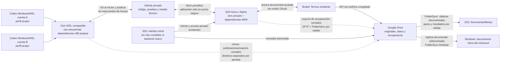

# MESTRY — Reorientación hacia la continuidad del trabajo

Fecha: **26 de octubre de 2026**, America/Santiago, UTC−03:00. Inspecciones nuevas desde aproximadamente las **21:25**. **Investigación y propuesta; no implementación.**

**Recomendación:** repositorios privados GitHub para el desarrollo, un clon independiente por entorno, dependencias locales por plataforma y dos acciones de trabajo: iniciar y finalizar/publicar. El S23 conserva Codex/Horus y funciona como nodo permanente; Windows desarrolla localmente; S25 accede al S23 y consulta documentos. Drive sigue siendo autoridad de los originales documentales seleccionados. **No se necesita un coordinador propio ni compartir conversaciones.**

La propuesta sustituye la recomendación D para estos requisitos corregidos; no modifica decisiones congeladas ni convierte las capacidades propuestas en funciones instaladas. Los siete informes anteriores permanecen como registro histórico:

| Informe revisado | Uso en esta reorientación |
|---|---|
| [01 — Entorno](01_AUDITORIA_ENTORNO_CODEX.md) | Conservar inventario y fronteras; actualizar aquí la observación de Horus |
| [02 — Sincronización](02_MAPA_SINCRONIZACION_REAL.md) | Reutilizar rutas, riesgos y distinción entre almacenamiento compartido y privado |
| [03 — Portabilidad](03_PORTABILIDAD_Y_PERSISTENCIA.md) | Conservar clasificación por plataforma; retirar continuidad de sesiones del objetivo |
| [04 — Comparación](04_COMPARACION_ARQUITECTURAS.md) | Revaluar D sin premiar la conservación del mismo hilo |
| [05 — Propuesta D](05_ARQUITECTURA_RECOMENDADA.md) | Simplificar componentes según §B de este documento |
| [06 — Plan anterior](06_PLAN_IMPLEMENTACION_Y_PRUEBAS.md) | Reemplazar sus incrementos dependientes del coordinador por §H |
| [07 — Evidencias](07_EVIDENCIAS_Y_LIMITACIONES.md) | Preservar resultados, fechas y limitaciones; no repetir pruebas históricas |

También se revisaron las [auditorías del 26/10](../../auditorias/2026-10-26/01_ESTADO_ACTUAL_MESTRY.md), su [mapa de infraestructura](../../auditorias/2026-10-26/02_INFRAESTRUCTURA_Y_SINCRONIZACION.md), [trazabilidad](../../auditorias/2026-10-26/03_TRAZABILIDAD_ARQUITECTONICA.md), [plan](../../auditorias/2026-10-26/04_PLAN_DE_CONTINUIDAD.md), [evidencias](../../auditorias/2026-10-26/05_EVIDENCIAS_Y_PRUEBAS.md), el [handoff remoto](../../validation/mestry-s23-remote-access-20261022T034500Z/HANDOFF.md) y el [ADR congelado Drive/RAG](../../../MESTRY_Arquitectura_Congelada_Google_Drive_Sincronizacion_RAG.md). No se reinició la auditoría ni se reconstruyeron los cinco originales Jarvis que siguen sin localizarse en la línea base.

## A. Corrección de requisitos

### A.1. La unidad de continuidad es el proyecto

Un agente nuevo debe encontrar **archivos actualizados, versiones identificables, instrucciones, estado y pruebas verificables**. Puede utilizar cualquier cuenta o hilo independiente. Una entrega reproducible relaciona un commit con sus datos externos, configuración portable y evidencia por plataforma; no contiene el estado mental del agente.

| Deja de ser requisito | Sigue siendo necesario |
|---|---|
| Misma conversación Windows↔S23 | Mismo contenido del proyecto para una versión determinada |
| Compartir IDs, historial o contexto interno entre cuentas | Documentación técnica suficiente para retomar |
| Trasladar una tarea/proceso en ejecución | Guardar cambios y publicar avances terminados |
| Windows conectado habitualmente al backend S23 | Windows capaz de desarrollar y probar localmente |
| Sincronizar homes, bases y autenticación Codex | Mantener cada instalación y cuenta independientes |
| Exportar conversaciones como handoff obligatorio | Actualizar estado, decisiones y pruebas del proyecto |

Las conversaciones locales pueden persistir normalmente en su instalación. Eso no impone trabajo de sincronización. La conexión **S25→Codex S23** sí permanece: es la interfaz móvil requerida, sin necesidad de que Windows la comparta.

### A.2. Qué significa «actualizado y funcional»

Debe distinguirse entre **publicado en GitHub**, **recibido en S23** y **validado para ejecutar en S23**. Un proyecto ocupado conserva su versión actual hasta un punto seguro. Un proyecto incompatible o con instalación fallida mantiene la última versión funcional y muestra el bloqueo. No existe una garantía razonable de actualización inmediata mientras se exige conservar tareas activas y trabajo local.

La admisión de cada proyecto requiere declarar capacidades: edición, pruebas Python/Node, ejecución, build Android u otras. El S23 será autónomo respecto del PC para las capacidades admitidas; no se promete inferencia Codex sin Internet ni compilación de cualquier proyecto x86 en ARM.

## B. Impacto sobre la propuesta D

### B.1. Componentes eliminados, simplificados y conservados

| Componente de D | Nueva decisión | Justificación y reemplazo mínimo |
|---|---|---|
| Cliente Windows del mismo bridge/backend | **Eliminar del camino requerido** | Codex local usa su clon; no hace falta desarrollar ese cliente |
| Helper/gateway Windows para consultar el mismo hilo | **Eliminar** | No aporta continuidad de archivos; conservar SSH existente para diagnóstico autorizado |
| Transferencia de conversaciones, IDs y homes | **Eliminar** | No existe ese requisito |
| Coordinador central de propietario por proyecto | **Eliminar** | Clones separados y ramas permiten trabajo independiente; Git controla la integración |
| Épocas, cesión global al PC y recuperación de leases | **Eliminar** | El S23 no debe dejar de desarrollar porque el PC tenga una sesión abierta |
| Servidor Git bare/receptor propio en S23 | **Eliminar del diseño inicial** | GitHub es el remoto común; S23 es un clon operativo, no un servidor de versiones adicional |
| Protocolo propio de transferencia, operation_id y recibos Git | **Eliminar** | Usar commits, refs, errores Git y consulta posterior del remoto |
| Recibo central «handoff confirmado» condicionado a backup | **Simplificar** | Informar publicación, recepción, ejecución y respaldo por separado; no bloquear toda entrega por un backup diferido |
| Handoff conversacional obligatorio | **Sustituir** | Estado breve versionado, historial Git y enlaces a pruebas |
| Admisión de escritores y tareas en un mismo checkout | **Conservar localmente** | Un workspace compartido sí necesita uso exclusivo o worktrees separados; no hace falta arbitraje entre dispositivos |
| Staging y validación por plataforma | **Conservar cuando corresponda** | Evitar cambiar dependencias o una versión operativa sin validar el reemplazo |
| Cápsulas completas por cada tarea | **Simplificar** | Manifiestos/locks e instalaciones locales; respaldos por plataforma según necesidad de recuperación, sin empaquetarlo todo en cada commit |
| Backups de conversaciones para continuidad | **Eliminar como obligación** | Recuperación personal opcional separada; fuera del intercambio de proyectos |
| Backups de código, datos únicos y entornos difíciles de reconstruir | **Conservar** | GitHub no incluye cambios sin commit, datos ignorados ni toda la cadena de ejecución |
| Horus, bridge S25, Termux, SSH/Tailscale y supervisión existentes | **Conservar** | Sirven a disponibilidad/acceso móvil, independientemente de compartir hilos con Windows |
| Controlador documental y separación de OAuth | **Conservar** | Decisiones congeladas de permisos, revisión y escritura segura en Drive |

### B.2. Por qué Git es suficiente y dónde no lo es

Git intercambia versiones y detecta divergencia de historia. Un push normal a una rama rechaza una actualización que no sea fast-forward; después hay que integrar y revisar ambos cambios. Eso reemplaza la parte de D que reinventaba aceptación de versiones. [Git push](https://git-scm.com/docs/git-push).

Git **no impide que dos agentes modifiquen a la vez el mismo archivo sin confirmar en WSL**. Tampoco incorpora automáticamente archivos nuevos, ignorados, buffers de editor, datos externos o dependencias. Para esos límites bastan aislamiento por worktree cuando haya simultaneidad, una exclusión local cooperativa y una lista explícita de entregables. No se ofrece aislamiento frente a procesos del mismo UID que ignoren el procedimiento.

## C. Horus actualizado, GitHub y estado real

### C.1. Evidencia nueva de la instalación

Estados usados: **dispositivo** = lectura actual; **usuario** = confirmación humana; **fuente oficial** = documentación/código del proveedor; **inferido** = conclusión con límites; **pendiente** = sin prueba en la instalación.

| Elemento | Resultado | Autoridad y límite |
|---|---|---|
| Identidad S23 | SM-S918B, Android 16/API 36, arm64-v8a | **Dispositivo**, reconfirmado antes de las lecturas |
| Horus instalado | **1.1.0 / versionCode 6**; última actualización **26/10 21:10:11**; UID 10350 y directorio privado conservados | **Dispositivo**. Reemplaza la observación 1.0.4 de las 20:32, no la invalida retrospectivamente |
| APK actual | SHA-256 `e954353518feb660a8a1941a8d549b8def5ebccf338e816c75d484c7aa6e6012` | **Dispositivo**, hash leído sin copiar/instalar el APK. No se obtuvo coincidencia binaria con un artefacto oficial 1.1.0 |
| Distribución activa | **Alpine** | **Usuario**, respuesta durante esta investigación. No se leyó `/etc/os-release` dentro del guest actual |
| Distribuciones ofrecidas por 1.1.0 | Alpine **3.24.0** y Debian **13.7 ARM64**, este último experimental | **Fuente oficial fijada por tag**, no prueba de que ambos estén instalados |
| Codex S23 actual | Funcional según usuario; versión **0.163.0** solo acreditada en experimentos anteriores | **Usuario/histórico**. No se ejecutó su binario después de la actualización |
| Procesos Horus | Proceso de app y `:terminal` presentes | **Dispositivo**. Existencia del proceso no demuestra una tarea Codex activa |
| Acceso remoto Horus | Provider: `configured=true`, **`enabled=false`, `state=stopped`**, puerto configurado 8022, una clave registrada | **Dispositivo**. No se activó ni emparejó nada; no se atribuye una causa al cambio |
| Bridge MESTRY | GET a `127.0.0.1:8787/healthz` desde Termux: conexión rechazada | **Dispositivo**. No se confirmó acceso S25→Codex en esta muestra |
| Termux | SSH existente 8023 autentica; UID 10348, aarch64; Python disponible | **Dispositivo**. Git/gh/node/rclone no resueltos en ese PATH; no implica ausencia dentro de Horus |
| FolderSync S23 | **4.14.0**, UID 10353; proceso presente en primera muestra | **Dispositivo**. No se leyeron pares ni logs privados; no se ejecutó sincronización |
| S25 | SM-S938B, Android 16/API 36, ARM64; sin procesos pertinentes observados en primera muestra | **Dispositivo**. Cliente piloto8 y conexión celular son evidencias históricas; no se abrió la app |
| Energía/temperatura | USB=true, AC=false, batería 79%; muestra posterior **25,0 °C**; provider thermal=0 | **Dispositivo**, fotografías puntuales. No acredita cargador de pared, PC apagado o disponibilidad prolongada |
| MESTRY WSL | Continúa sin `.git`; Git **2.43.0**, gh **2.45.0** disponibles | **Local**, inspección actual. No se creó repositorio, rama o commit |
| Repositorio remoto MESTRY | **No existe según confirmación explícita del usuario** | **Usuario**. Consulta GET exacta `repos/<cuenta WSL>/mestry` devolvió 404; no prueba ausencia en todas las cuentas/organizaciones ni identifica la cuenta Horus |

El código oficial se fijó a **`v1.1.0` → `76da90789f039fe7ee796ae4ec44c1628fda2031`**, que declara versionCode 6. No se usó `main` como si fuese el binario instalado: la rama consultada ya declaraba **1.1.1 / 7**. La API de releases solo enumeraba 1.0.4, 1.0.3 y un rootfs Debian; una lista de releases incompleta para esta instalación no contradice el paquete 1.1.0 observado. [Tag 1.1.0](https://github.com/scarif-labs/horus/tree/76da90789f039fe7ee796ae4ec44c1628fda2031), [versionado](https://github.com/scarif-labs/horus/blob/76da90789f039fe7ee796ae4ec44c1628fda2031/android/app/build.gradle), [releases](https://github.com/scarif-labs/horus/releases).

### C.2. Distribuciones, persistencia y permisos

El catálogo oficial mantiene Alpine como opción predeterminada y ofrece el rootfs Debian por separado. Sus versiones fijadas no son un inventario de paquetes actualizados dentro de un guest. [Catálogo](https://github.com/scarif-labs/horus/blob/76da90789f039fe7ee796ae4ec44c1628fda2031/android/app/src/main/java/com/scariflabs/horus/terminal/RootfsCatalog.kt), [Alpine fijado](https://github.com/scarif-labs/horus/blob/76da90789f039fe7ee796ae4ec44c1628fda2031/android/app/src/main/java/com/scariflabs/horus/terminal/AlpineRootfsCatalog.kt).

La implementación separa rootfs, home y homes de cada harness; Debian tiene homes distintos de Alpine. El workspace predeterminado permanece en `horus/workspaces/default`, enlazado por PRoot a `/workspace`. La fábrica de sesiones utiliza ese workspace para terminales/harness y acceso remoto. **Inferencia:** los proyectos son persistentes en almacenamiento de app y compartibles entre esos perfiles; eso no vuelve compatibles los entornos `.venv` o `node_modules` que un proyecto guarde dentro. [Rutas persistentes](https://github.com/scarif-labs/horus/blob/76da90789f039fe7ee796ae4ec44c1628fda2031/android/app/src/main/java/com/scariflabs/horus/terminal/DistroStorePaths.kt), [fábrica de sesiones](https://github.com/scarif-labs/horus/blob/76da90789f039fe7ee796ae4ec44c1628fda2031/android/app/src/main/java/com/scariflabs/horus/terminal/TerminalSessionSpecFactory.kt).

La nota oficial de 1.1.0 advierte que cambiar de usuario detiene las sesiones del otro. Por eso un cambio de distro no se trata como una preferencia visual inocua durante una tarea. No se cambió usuario, no se probó persistencia mediante reinicio ni se migraron instalaciones. [Cambios 1.1.0](https://github.com/scarif-labs/horus/blob/76da90789f039fe7ee796ae4ec44c1628fda2031/fastlane/metadata/android/en-US/changelogs/6.txt).

La separación con FolderSync sigue siendo material:

| Dominio | Ruta/identidad | Conclusión |
|---|---|---|
| Workspace Horus | Datos privados de `com.scariflabs.horus`, UID 10350; guest `/workspace/projects` | Ubicación recomendada del clon S23; contenido privado actual no inventariado |
| Réplica FolderSync | `/storage/emulated/0/Documents/Mestry`, UID FolderSync 10353 | Árbol compartido diferente; no es el checkout privado |
| Copia compartida MESTRY | `Documents/Mestry/Villegol/Proyectos/mestry` | Existe; ADR con SHA-256 idéntico al local; sin `.git` en esa ruta |
| Termux | Home privado de UID 10348 | SSH aquí no concede acceso al home Horus |

Horus 1.1.0 no declara permiso general de archivos ni receptor BOOT en el manifiesto oficial; su acceso `MANAGE_EXTERNAL_STORAGE` observado figura `default`. Exportar a Downloads mediante MediaStore no equivale a montar documentos compartidos como workspace. Un symlink no otorga permisos entre UIDs. [Manifiesto 1.1.0](https://github.com/scarif-labs/horus/blob/76da90789f039fe7ee796ae4ec44c1628fda2031/android/app/src/main/AndroidManifest.xml), [permisos Android](https://developer.android.com/training/data-storage/manage-all-files).

**Pendiente de lectura dentro del perfil Horus ya abierto:** versión real de Alpine/libc, Codex/Node/Python/Git/gh, home efectivo de Codex, ubicación de credenciales Git por metadatos, proyectos y dependencias existentes. No se accedió a datos privados desde WSL, no se usó root/run-as ni se arrancó remoto para obtener esa información. Una comprobación futura debe revisar primero los launchers: abrir una ficha de herramienta o usuario puede iniciar aprovisionamiento; no se usa como prueba de lectura.

### C.3. Qué habilita GitHub en Horus

La conexión comunicada por el usuario tiene soporte real en el código oficial: Horus usa **GitHub CLI (`gh`) dentro del guest**, consulta identidad y repositorios y permite clonar un repositorio seleccionado. El listado llama a `user/repos` con afiliaciones owner/collaborator/organization_member y límite **100**, sin paginación en esa función. Un repositorio ausente del menú no demuestra ausencia global. La identidad mostrada puede estar cacheada; no prueba validez actual del acceso. [Listado](https://github.com/scarif-labs/horus/blob/76da90789f039fe7ee796ae4ec44c1628fda2031/src/projects/githubRepositories.ts), [identidad cacheada](https://github.com/scarif-labs/horus/blob/76da90789f039fe7ee796ae4ec44c1628fda2031/src/projects/githubAccountStore.ts).

La selección GitHub ejecuta `gh repo clone`; una URL usa `git clone`. Si ya existe un checkout del mismo remoto, el flujo lo reutiliza y sale: **no realiza pull para actualizarlo**. Si la carpeta pertenece a otro proyecto, la deja intacta. Abrir Codex en un proyecto selecciona su directorio, pero no implementa cierre/publicación automática. [Comandos de proyectos](https://github.com/scarif-labs/horus/blob/76da90789f039fe7ee796ae4ec44c1628fda2031/src/projects/projectCommands.ts).

| Operación | Capacidad documentada/inferida | Estado en este S23 |
|---|---|---|
| Login GitHub | Flujo de dispositivo/navegador; interacción humana para autorizar | Conectado **según usuario**; no se repitió login |
| Listar repos privados autorizados | `gh api` con los permisos efectivos | Implementado en fuente; listado actual no consultado desde Horus |
| Clonar | Función de Horus y Git/gh | No probado aquí; clonación escribe y no está autorizada en esta fase |
| Fetch/pull | Git desde la terminal; no actualizador automático demostrado en la UI | Pendiente de credencial, perfil y prueba |
| Commit | Git local; requiere identidad de autor y selección de cambios | Posible si herramientas disponibles; no necesita permiso remoto para crear el commit |
| Push/PR | Git/gh y autorización del repositorio/rama | Permiso efectivo y funcionamiento **pendientes**; conexión no prueba escritura |
| Actualización/publicación por tarea | Scripts y puntos de entrada descritos en §F | **Propuesto**, no función ya acreditada de Horus |

La identidad GitHub no es la cuenta ChatGPT/Codex. Las dos cuentas Codex Windows pueden trabajar sobre los mismos archivos y publicar con la identidad Git autorizada de ese entorno; también pueden usarse identidades Git diferentes si el usuario lo necesita. La atribución `user.name/user.email` de un commit no concede permisos de push.

Debe comprobarse que el perfil **Codex**, además del perfil usado para GitHub, resuelva la autenticación Git. Los homes separados hacen que no sea una consecuencia automática del login. `gh auth setup-git` configura el helper, pero **es una modificación de configuración** y aquí no se ejecutó. GitHub CLI puede usar un almacén seguro o recurrir a un archivo de texto si no existe; no se asume Keystore ni protección equivalente dentro del guest. [Helper Git](https://cli.github.com/manual/gh_auth_setup-git), [almacenamiento de gh](https://cli.github.com/manual/gh_auth_login).

La validación posterior más pequeña es GET de metadatos de **un repositorio permitido**, proyectando solo `private`, rama predeterminada y `permissions`, y lectura de refs con `git ls-remote`; no `gh auth token`, `credential fill`, volcado de configuración o URL con token. Los scopes se revisan en **Authorized OAuth Apps** sin copiar tokens. Permiso general de escritura tampoco garantiza permiso sobre una rama protegida. Una prueba sintética aprobada confirmará finalmente el push. [Metadatos de repositorios](https://docs.github.com/en/rest/repos/repos#get-a-repository), [revisión OAuth](https://docs.github.com/en/apps/oauth-apps/using-oauth-apps/reviewing-your-authorized-oauth-apps), [refs remotas](https://git-scm.com/docs/git-ls-remote).

## D. Arquitectura mínima recomendada

### D.1. Topología y responsabilidades

Las flechas describen el **objetivo propuesto**, no sincronizaciones actualmente aceptadas. En particular, el acceso remoto Horus está deshabilitado en la muestra y no existe repositorio MESTRY.

| Componente | Responsabilidad concreta |
|---|---|
| GitHub | Punto común de publicación e integración; historia del desarrollo y rama acordada `main` |
| S23 | Nodo operativo principal, proyectos admitidos y versiones funcionales; runtime Codex propio; tareas y acceso remoto |
| WSL | Desarrollo local potente, ambas cuentas sobre el mismo proyecto de forma secuencial; trabajo paralelo mediante worktrees |
| S25 | Abrir proyectos/hilos en S23, supervisar tareas, ver documentos y errores; no motor de sincronización de checkouts |
| Drive | Autoridad documental, datos autorizados y recuperación; publicaciones Git identificadas como derivadas |
| FolderSync | Réplicas de documentos y transporte de exports cerrados; nunca sincronizar el checkout o `.git` vivos |
| rclone WSL | Copias verificadas de datasets/exports y publicaciones aprobadas; no transporte del workspace operativo |
| Scripts pequeños | Preflight, controles de publicación, actualización segura y resumen local; sin servidor ni protocolo propio |

`main` representa el estado integrado, no una garantía universal de ejecución. Los cambios terminados y secuenciales pueden publicarse allí mediante fast-forward normal. Para tareas simultáneas, cambios aún no admitidos o trabajo offline divergente se usan ramas `work/<equipo>-<tarea>` y una integración revisada, preferentemente mediante PR. No se obliga a ejecutar un sistema de PR para cada cambio trivial ni a resolver divergencias automáticamente.

### D.2. Ubicaciones y coexistencia con sincronizadores actuales

Se propone un checkout WSL nuevo en **`/home/developer/mestry-workspaces/mestry`**, fuera de la raíz `proyectos` que hoy abarca bisync. En S23: **`/workspace/projects/mestry`** dentro de Horus, sin mover el fixture `mestry-horus-smoke`. Rutas **futuras, no creadas**.

El directorio actual permanece intacto hasta aprobar selección de fuentes, comparación y tratamiento de su copia Drive. No basta añadir `.gitignore`: sus reglas no gobiernan FolderSync/rclone y tampoco afectan archivos ya seguidos por Git. La retirada futura de un árbol de bisync requiere reconciliar sus listados y destinos, sin `--resync` automático. [Git ignore](https://git-scm.com/docs/gitignore), [bisync](https://rclone.org/bisync/).

Las fuentes completas del cliente/bridge que hoy están en caché deben preservarse en una base duradera y revisada, con procedencia, licencias, pins y parches. No se crea un commit inicial de todo el árbol, capturas y configuraciones privadas por defecto. La línea base anterior identifica 68 huellas de fuentes del piloto: son evidencia para esa selección, no un repositorio MESTRY ya existente.

El cliente S25 está acreditado históricamente para **un proyecto sintético**, no como catálogo general listo para estos repositorios. Admitir `mestry` requerirá revisar su configuración/allowlist y comprobar creación de hilo con el cwd correcto, sin alterar por arrastre el piloto o los permisos del shell. Es adaptación del cliente existente, no un backend adicional.

### D.3. Dos cuentas Windows sin compartir homes

Los perfiles Codex permanecen fuera del repo y de cualquier par de sincronización. Se observan los directorios `.codex` y `.codex-account-2`; no se verificó aquí qué cuenta corresponde a cada uno. No hace falta crear `.codex-account-1` ni reautenticar por convención de nombre. El mecanismo oficial permite elegir un home Codex independiente; el proyecto conserva instrucciones comunes en `AGENTS.md`. [Guía oficial](https://learn.chatgpt.com/docs/agent-configuration/agents-md).

Se conservan los launchers/perfiles existentes y ambos abren el mismo directorio WSL cuando trabajan por turnos. Si trabajan a la vez, cada agente utiliza una rama y worktree distinto, compartiendo historia, no archivos de trabajo ni índice. [Git worktree](https://git-scm.com/docs/git-worktree).

Separar homes evita mezclas funcionales; con el mismo usuario Unix y acceso completo **no constituye aislamiento de seguridad** entre agentes. Si se exige impedir técnicamente que una cuenta lea credenciales de la otra, hacen falta usuarios del SO separados y acceso compartido solo al proyecto. No se cambiarán usuarios, ACL ni permisos en esta fase.

## E. Política de archivos, dependencias y reproducción

### E.1. Destino de cada clase

| Material | Autoridad/control | Tratamiento local y recuperación |
|---|---|---|
| Código, scripts, pruebas y fixtures pequeños no sensibles | Git/GitHub | Mismos bytes del commit, con política de EOL y ejecutables en `.gitattributes` |
| README, instrucciones de agente, estado y documentación técnica propia | Git/GitHub, después de clasificar el documento | Drive puede tener una publicación derivada, nunca segundo original editable |
| Originales académicos/personales/proyectos seleccionados en Drive | **Drive**, D-02 | Réplicas/exports con ID y revisión; escritura por controlador según ADR |
| Docs/Sheets/Slides nativos | Workspace/Drive | Editar por API estructurada; export no sustituye al original |
| `pyproject.toml`, requirements, locks; `package.json` y lock; scripts bootstrap | Git | Versiones de runtime y perfiles de SO explícitos; sin secretos |
| `.venv`, `venv`, `node_modules` | Instalación **local por plataforma** | Conservar mientras funcionen; excluir de transporte no significa borrar |
| Paquetes Alpine/Debian/Ubuntu | Gestor local correspondiente | Inventario/receta versionables; paquetes binarios separados por distro/arquitectura |
| Binarios, wheels, addons y compilaciones | Artefactos por target y hash | No copiar x86-64/glibc sobre ARM64/musl; conservar binarios únicos autorizados |
| APK/releases finales | Artefacto cerrado, versión/hash y procedencia | Drive o canal de releases autorizado; claves de firma fuera de Git y sync |
| Bases de datos con datos únicos | Motor dueño y respaldo coherente | Export/backup soportado; schema/migraciones en Git; no DB viva por carpeta |
| Índices, caches, temporales, logs y locks | Estado local | Reconstruir cuando proceda; preservar resultados únicos antes de ignorarlos |
| Datasets/recursos grandes | Drive u origen autorizado por revisión/hash | Manifest pequeño en Git; descarga local seleccionada, sin repo gigante por defecto |
| Resultados no reproducibles | Artefactos únicos autorizados | Guardar inputs/config/versión y evidencia; no clasificarlos como cache automáticamente |
| `.git` | Git local | Intercambiar objetos/refs por Git; no replicar físicamente por Drive |
| `.env` reales, OAuth, SSH, auth Codex, configuraciones con secretos | Almacén privado del entorno | Aprovisionamiento/recuperación separados; `.env.example` solo saneado en Git |
| Homes e historiales Codex | Cada instalación/cuenta | Fuera de la continuidad del proyecto y de los pares documentales |

No se excluyen indiscriminadamente todos los JSON, binarios, bases o archivos generados: algunos son fixtures o resultados únicos. La lista final se decide por ruta y función. Un archivo ignorado que sea necesario para ejecutar debe estar en el manifiesto de recursos o en la receta de reconstrucción; no puede desaparecer del contrato por estar ignorado.

Git LFS es opcional cuando un proyecto lo necesite; versiona punteros a objetos externos. Un clon, bundle o backup de Git no garantiza que esos objetos ni los repositorios de submódulos estén disponibles. Para MESTRY inicialmente se prefieren datasets grandes en Drive con manifiesto, sin introducir LFS por defecto. [GitHub LFS](https://docs.github.com/en/repositories/working-with-files/managing-large-files/about-git-large-file-storage).

### E.2. Una sola autoridad por Markdown

Antes de incorporar documentos existentes, clasificar cada uno como **original Drive**, **documentación fuente del repo** o **publicación derivada**. La presencia actual bajo una carpeta sincronizada no basta para reasignarle autoridad.

Ejemplos propuestos:

- `docs/ARCHITECTURE.md` propio del desarrollo: se edita en Git; una copia Drive se publica bajo versión/commit, identificada como derivada y sin importación automática de ediciones.
- Un apunte académico original de Drive: se edita por su flujo documental; el repo contiene referencia por ID/revisión o snapshot autorizado de solo lectura, no un editor alternativo del original.
- El ADR congelado: se preserva íntegro. Si se incorpora una copia al repo, se identifica por origen y hash; no se convierte en permiso para reescribirlo desde Git.

Una edición humana sobre una publicación derivada se conserva y se convierte en una propuesta de cambio revisada; no se reimporta ciegamente sobre la fuente. Cada publicación indica ruta fuente, commit, hash y fecha. La publicación automática futura exige **destino y política previamente aprobados**, manteniendo D-07/D-08 y las confirmaciones que correspondan. No se amplía el publicador actual ni se reutiliza su destino antiguo en papelera.

Esto desarrolla la separación de fuentes que ya admitía la propuesta anterior; no modifica D-02. Si un Markdown ya es un original seleccionado en Drive y se quiere convertirlo en fuente Git, esa reclasificación requiere decisión expresa. Hasta entonces conserva su autoridad anterior.

### E.3. Dependencias: detectar cambios sin romper lo existente

La equivalencia de ejecución depende de **SO + arquitectura + libc + runtime/ABI + lock/configuración + datos**. Un venv contiene rutas y no se considera portable; los wheels distinguen plataformas como `manylinux` y `musllinux`; Node también puede cargar componentes nativos. [Python venv](https://docs.python.org/3/library/venv.html), [tags de paquetes Python](https://packaging.python.org/en/latest/specifications/platform-compatibility-tags/), [addons Node](https://nodejs.org/api/addons.html).

Flujo propuesto del comprobador local:

1. Identificar el target real y calcular una huella de manifiestos, locks, versiones de runtime, receta de instalación y opciones relevantes no secretas. No generar un `pip freeze` universal de WSL para aplicarlo a Alpine.
2. Comparar esa huella con la del último entorno aceptado en ese dispositivo; comprobar además imports/prueba mínima. Un marcador coincidente no detecta por sí solo una instalación dañada o modificada manualmente.
3. Si nada relevante cambió y la comprobación pasa, reutilizar el entorno. No reinstalar en cada sesión ni actualizar paquetes a «latest».
4. Si cambió la huella, conservar código y dependencias operativos. Preparar el candidato en **otra ubicación**, con su propio entorno, y ejecutar las pruebas del target. Fallos de red/compilación no deben tocar el entorno anterior.
5. Adoptar el candidato solo sin tareas usando la versión anterior y después de comprobar las rutas finales. **No mover un venv validado a otra ruta** esperando que sus shebangs se adapten: conservar su ubicación definitiva o reconstruir allí y probarla. Aplicar el mismo cuidado a herramientas con rutas incrustadas.
6. Registrar commit probado, target, huella, comandos, resultado y fecha fuera del control de versiones mutable del runtime. Conservar la versión anterior para rollback; no borrar dependencias automáticamente por antigüedad o por quedar ignoradas.

`npm ci` comprueba coherencia del lock, pero elimina el `node_modules` de su destino antes de instalar. Se ejecutaría únicamente en el candidato aprobado, nunca sobre el entorno operativo en uso. [npm ci](https://docs.npmjs.com/cli/v11/commands/npm-ci/).

La preparación puede utilizar un worktree Git en una ruta definitiva alternativa; no exige snapshots de kernel, contenedores ni un gestor propio de releases. Para dependencias Python puede utilizarse una ruta local estable por target/huella fuera del checkout; para Node, conservar el candidato con sus módulos cuando requieran su ruta. El proyecto debe documentar cómo se selecciona el entorno. Si los launchers actuales fijan una única ruta, se valida ese contrato antes de automatizar una promoción.

Un archivo global del sistema es compartido por proyectos: su actualización mediante `apk`/APT no queda aislada por crear otro venv. Las instalaciones/actualizaciones del runtime y las migraciones irreversibles de DB requieren una intervención separada con backup. No forman parte del pull automático.

### E.4. Alpine frente a Debian: decisión concreta

| Aspecto | Alpine actual | Debian en Horus | Evaluación para MESTRY |
|---|---|---|---|
| Continuidad operativa | Entorno que el usuario está utilizando | Opción experimental en 1.1.0 | Mantener Alpine; no migrar para homogeneizar nombres con Ubuntu |
| libc/herramientas | musl, BusyBox, paquetes APK | Entorno GNU/glibc y paquetes APT | Debian puede facilitar una dependencia disponible para ARM64/glibc sin alternativa musl |
| Python/Node nativos | Exigir wheel/addon ARM64/musl o compilación compatible | Puede aprovechar variantes ARM64/glibc | La disponibilidad concreta se evalúa con las dependencias del proyecto, no por reputación de distro |
| Arquitectura | ARM64 | ARM64 | Ninguna ejecuta un binario x86-64 por cambiar de distro |
| Restricciones Android/PRoot | Kernel, UID y ciclo de vida Android | Los mismos límites estructurales | Debian no añade namespaces/root Android, systemd funcional ni autorrecuperación por sí solo |
| Homes y sesiones | Conservados en su perfil | Homes distintos; cambio de usuario detiene sesiones del otro | El coste incluye revalidar herramientas y permisos, no solo descargar rootfs |
| Espacio/CPU | Ventaja potencial de ligereza | Coste mayor de instalación según carga | No es el criterio decisivo del usuario; pesan estabilidad y compatibilidad probada |

Alpine documenta musl/BusyBox; el beneficio esperado de Debian es una **inferencia de compatibilidad**, no un benchmark ejecutado. [Alpine](https://alpinelinux.org/about/), [Debian ARM64](https://www.debian.org/releases/trixie/).

**Umbral para reconsiderar Debian:** una dependencia imprescindible falla de forma reproducible en Alpine, existe una solución ARM64/glibc concreta y un ensayo paralelo aprobado demuestra mejor ejecución/recuperación sin perder el entorno operativo. La facilidad de cambiar usuario no satisface esas condiciones. Android Studio continúa sin soporte oficial para hosts Linux ARM; usar Debian no convierte el S23 en un host de build Android equivalente al PC. [Requisitos de Studio](https://developer.android.com/studio/install#linux).

## F. Automatización del trabajo y contexto compartido

### F.1. Superficie mínima de automatización

Se proponen **un script Bash de sesión** con operaciones `start`, `finish`, `receive` y `check`, más un comprobador de entorno. Un acceso directo PowerShell puede llamar a WSL conservando cwd y código de salida. Nombres de trabajo: `tools/work-session.sh`, `tools/check-env.sh`, wrapper opcional `tools/WorkSession.ps1`. **No se crearon ni ejecutaron.**

La configuración local mantiene ruta real, remoto autorizado sin credenciales embebidas, rama, target y comandos de prueba. Se registra estado por proyecto fuera de carpetas sincronizadas: commit local/remoto observado, último intento/éxito, cambios pendientes y resultado de entorno. Es un resumen reconstruible desde Git/logs; no una base distribuida de propietarios ni un protocolo de mensajes.

### F.2. Inicio de trabajo en Windows

1. Seleccionar el perfil Codex existente y el proyecto; adquirir uso exclusivo **local del checkout** antes de invocar editores, Git o pruebas. Ambas cuentas deben utilizar el mismo punto de entrada. Si está ocupado, reutilizar la sesión responsable o elegir otro worktree.
2. Inspeccionar estado Git, incluidos índice, cambios seguidos, archivos nuevos, operación merge/rebase incompleta y commits locales no publicados. Identificar recursos ignorados requeridos por manifiesto. No auto-stash, reset, clean, checkout forzado ni commit de rescate de secretos.
3. Ejecutar fetch del remoto acordado. **Fetch escribe objetos/refs locales, pero no actualiza por sí solo los archivos de trabajo**; está propuesto para implementación, no ejecutado en esta investigación. Comparar la base local con la ref recién obtenida. [Git fetch](https://git-scm.com/docs/git-fetch).
4. Si el árbol está limpio y la historia solo está atrasada, aplicar fast-forward con `git merge --ff-only origin/main` después de fetch, o `git pull --ff-only`. Si está adelantada, revisar lo pendiente; si diverge, detener integración automática. Incluso cambios locales que Git pudiera conservar bloquean este inicio automático conservador. [Git pull](https://git-scm.com/docs/git-pull).
5. Actualizar únicamente las réplicas documentales seleccionadas por el motor que les corresponda y comprobar su resultado final. Un documento opcional desactualizado se señala; un dataset indispensable ausente bloquea la tarea que lo necesita.
6. Comprobar entorno/recursos según §E.3, leer instrucciones y estado del proyecto, y mostrar la base efectiva. Sin red, permitir trabajo offline explícitamente identificado sobre la última base conocida, sin presentar el remoto como actualizado.

Durante la sesión no hace falta sincronización continua con el S23. Si ambas cuentas trabajan secuencialmente sobre ese directorio, la segunda ve también cambios locales aún no publicados; eso no prueba que hayan llegado a GitHub ni al teléfono.

La exclusión local debe cubrir **toda la sesión escritora, instalaciones y pruebas con efectos**, no solo el comando Git. Puede implementarse con `flock` si está disponible, fuera del repo, y un supervisor local que mantenga el descriptor mientras corresponda. No cerrar el control si quedan hijos escritores. Un lock vacío no detecta un editor externo: los proyectos con sesiones no gestionadas quedan fuera de la aplicación automática hasta confirmar reposo.

### F.3. Finalizar y publicar desde Windows o S23

El mismo cierre se aplica a los dos entornos, con sus pruebas propias:

1. Guardar archivos y terminar tareas escritoras. Revisar diff, untracked y artefactos únicos. No se puede rescatar un buffer que el editor nunca guardó.
2. Separar el trabajo de esta tarea de modificaciones preexistentes; actualizar el estado técnico y enlaces a pruebas realmente ejecutadas. Aplicar la política de versiones del proyecto: manifiestos/locks si cambiaron dependencias y versión de release cuando corresponda. Una salida cero del modelo no demuestra calidad del código.
3. Seleccionar rutas explícitas. Revisar nombres/tamaños, contenido staged, secretos conocidos, archivos generados y binarios. Examinar **todos los commits locales que saldrían**, no solo el último diff: un secreto en un commit intermedio también se publicaría. No usar un `git add` indiscriminado como política.
4. Ejecutar las comprobaciones acordadas sobre el candidato y verificar que no hubo ediciones después. Instaladores/builds pueden ejecutar código del repo; el agente no debe alterar silenciosamente la política de publicación o el validador que autoriza su propio cambio.
5. Crear un commit únicamente para el conjunto revisado y coherente. Si una tarea quedó incompleta, conservar archivos y marcarla pendiente; un checkpoint local o rama WIP solo se crea/publica si la política lo autoriza. No se sube a `main` por el mero hecho de terminar un turno.
6. Reconsultar el remoto. Sin divergencia, push normal de la rama explícita; con divergencia, conservar ambas historias y preparar una integración revisada. Si la política del repo exige PR, publicar la rama y abrir PR; mostrar que todavía no está integrado en `main`.
7. Verificar el commit remoto mediante refs/consulta posterior. Si la rama avanzó por otra entrega, comprobar que contiene el commit enviado; no interpretar cualquier SHA distinto como pérdida. Un timeout exige primero comprobar si el commit llegó, antes de crear otro commit o repetir efectos auxiliares.
8. Informar por separado cambios excluidos, commits pendientes, publicación GitHub, recepción/validación S23 y respaldo. Liberar el uso local al finalizar el trabajo sobre el checkout; nunca borrar cambios para obtener un estado verde.

El comando de cierre puede llamarse automáticamente por el agente **cuando se apruebe una política de publicación por proyecto** con rutas, remoto/rama, pruebas y excepciones definidas. Si las condiciones no se cumplen, se detiene y comunica el pendiente. Así se automatiza la tarea rutinaria sin convertir cualquier modificación en un commit ni exigir confirmación de usuario en cada operación ya autorizada. Un scanner reduce riesgo, pero no demuestra ausencia universal de secretos; en la primera línea base y casos fuera de política se requiere revisión del conjunto concreto.

Hooks Git `pre-commit`/`pre-push` pueden ejecutar validadores; no se distribuyen/activan mágicamente por clonar y algunos pueden omitirse. No se usan como único control. [Hooks Git](https://git-scm.com/docs/githooks).

La documentación actual de Codex incluye hooks `Stop` y `SessionEnd`. **No se probó su disponibilidad/configuración en el Codex S23 actualizado.** `Stop` corresponde al final de un turno y no certifica que el proyecto esté entregable; `SessionEnd` tiene disparadores propios y no sustituye al cierre de tarea. Si se adoptan, inicialmente solo recordarán/verificarán pendientes; no harán push incondicional. Tampoco cubren apagado abrupto. [Hooks oficiales de Codex](https://learn.chatgpt.com/docs/hooks).

### F.4. Actualización automática del S23 sin sobrescribir trabajo

**Política seleccionada: fetch periódico y aplicación en puntos seguros.**

- Un trabajo ligero, dentro del entorno Horus existente y con programación validada, consulta el remoto con intervalo moderado y backoff. Cinco minutos puede ser un punto inicial de ensayo, no una promesa de puntualidad ni un valor congelado. No se presupone cron disponible ni se instala un scheduler ahora.
- El trabajo de fondo puede actualizar objetos y refs, con operaciones Git locales serializadas. **No hace pull sobre el checkout mientras Codex, un editor, pruebas o procesos del proyecto lo usan**, aunque `git status` salga limpio.
- `start`/apertura de proyecto ejecuta `receive` antes de admitir trabajo. Si está limpio, libre y sin divergencia, valida la nueva versión; si cambia entorno, prepara candidato separado. Una sincronización automática puede completar su aplicación al terminar la última sesión gestionada y liberar el proyecto.
- Hasta instrumentar todos los puntos de entrada del piloto S25/Horus, el modo seguro es **solo fetch + aviso**; no afirmar que un cron con `pull --ff-only` identifica tareas activas. Para la app-server persistente hace falta un preflight pequeño en la apertura del proyecto y señal local de uso en su ciclo de tarea, incluyendo trabajos de fondo. Es integración local del bridge existente, sin propietario global ni servicio nuevo.
- Si el proyecto está ocupado, sucio o adelantado sin publicar, se conserva y se muestra por qué no se aplicó. Un agente nuevo recibe esa información antes de editar. Una tarea no debe comenzar sobre archivos cuya preparación todavía está incompleta.
- Después de validar el candidato y al quedar libre, aplicar la versión acordada o seleccionar su directorio definitivo, según el contrato de rutas del proyecto. Si falla la instalación o prueba, conservar la versión aceptada y el candidato para diagnóstico. No promover dependencias ni migraciones a medias.

Publicar desde S23 reutiliza el cierre anterior con GitHub directamente; no pasa por Windows. Actualización y publicación son operaciones diferentes: el monitor no genera commits de cualquier archivo que detecte.

### F.5. Documentos, datos y backups mediante herramientas existentes

Para documentos humanos se mantienen FolderSync Android/Desktop y sus pares, una vez identificados y aceptados. La UI S25 puede consultar Drive directamente o mediante el broker del S23; no necesita descargar todo. Los documentos destinados a Codex se leen mediante la capacidad acotada del broker existente, sin entregarle OAuth ni suponer acceso a la réplica SAF.

Si un dataset o respaldo necesita entrar/salir del guest y excede la capacidad del broker, la primera vía a **validar** es SFTP del acceso Horus existente con FolderSync, hacia una zona de intercambio separada de los checkouts. La herramienta soporta Drive y SFTP; eso no acredita todavía autenticación, permisos ni ejecución del par loopback en este equipo. Los inputs se descargan a un inbox y solo se aceptan al verificar el conjunto/hash esperado; los backups salen como archivos cerrados con nombre único. No son sincronizaciones bidireccionales del proyecto. [Servicios FolderSync](https://foldersync.io/docs/help/supportedservices/).

Para backups S23 autónomos: export dentro del UID Horus → lectura SFTP de esa zona por FolderSync → publicación en raíz de recuperación aprobada. Sin copiar `.codex`, OAuth o DB activas por defecto. Esto evita extender ahora el publicador de fixtures de 64 KiB a un protocolo propio de grandes transferencias. Requiere aprobar autenticación/rutas/pares y probar el circuito completo; **actualmente remoto Horus está deshabilitado**. No se instala rclone en S23 solo para eludir ese pendiente.

En WSL ya existe rclone; su uso futuro se limita a datasets/publicaciones/exports seleccionados. `copy` no borra archivos adicionales del destino, pero puede reemplazar archivos del mismo nombre: usar versiones únicas, destino de alcance fijo y verificación posterior. No llamar backup a una carpeta mutable de dos vías. Retención, cifrado y eliminación requieren política separada. Para SQLite, exportar con el mecanismo del motor y probar restore. [rclone copy](https://rclone.org/commands/rclone_copy/), [SQLite Backup API](https://sqlite.org/backup.html).

FolderSync documenta programación y automatización por eventos/resultados; su CLI Desktop permite consultar estado/logs y disparar un par, **requiere la app Desktop funcionando y se distribuye aparte**. No se encontró `foldersync-cli` en el PATH WSL; no se inspeccionó su disponibilidad Windows ni se instaló. Un comando que dispara sync no demuestra que terminó correctamente. [Automatización](https://foldersync.io/docs/help/automation/), [CLI Desktop](https://foldersync.io/docs/help/cli/).

No se añaden webhooks ni mensajería para enterarse de errores: primero logs/estado de las herramientas y un resumen consultable desde el cliente/terminal existente. Una futura notificación fuera del nodo solo se justifica si se requiere detectar su caída completa; un S23 apagado no puede informar su propio fallo.

### F.6. Confirmación de éxito y cierre sin hook de apagado

| Estado informado | Evidencia mínima |
|---|---|
| Guardado local | Archivos guardados; aún puede no haber commit |
| Versionado local | Commit identificado; recursos externos pendientes enumerados |
| Publicado GitHub | Ref remota contiene el commit; rama/PR y fecha verificadas |
| Recibido S23 | El clon S23 confirma presencia del commit; no solo GitHub ni `origin/main` de WSL |
| Listo S23 | Versión seleccionada y pruebas/entorno del target aceptados |
| Respaldo verificado | Export remoto íntegro y formato de restauración probado según política |

El monitor local puede emitir un JSON/texto por proyecto con estos campos y su antigüedad, visible desde S25 por las capacidades existentes o una adaptación mínima. **No existe aún un comando del cliente que entregue esta vista.** Si Windows no dispone de lectura autorizada del estado S23, su cierre confirma GitHub y deja recepción/ejecución S23 pendientes; no se extrae una clave del S25 para rellenar ese hueco.

La publicación no depende de que S23 esté disponible en ese instante: puede recogerla después. Para afirmar «llegó al S23» hace falta su comprobación. Un apagado Windows inesperado deja trabajo local sin publicar; al siguiente inicio se detecta. Puede añadirse un recordatorio de sesión pendiente o comprobación programada **sin escrituras**, pero ningún hook al apagar garantiza conservar lo que nunca se guardó o envió.

### F.7. Contexto verificable para un hilo nuevo

Ya existen `README.md`, `docs/ARCHITECTURE.md`, `docs/DECISIONS.md`, `docs/ROADMAP.md`, guías de herramientas y handoffs de validación. Se reutilizan sus responsabilidades; algunos encabezados conservan estados históricos superados y necesitarán una actualización editorial separada. No se crean copias en raíz con los mismos nombres.

Solo se proponen como nuevas entradas generales **`AGENTS.md`** y **`docs/STATUS.md`**, si se aprueba la implementación:

| Archivo | Contenido y mantenimiento |
|---|---|
| `AGENTS.md` | Cómo abrir/verificar/cerrar el proyecto, rutas de documentación, pruebas por plataforma, límites de archivos y política de publicación; corto, sin historial de mensajes |
| `README.md` | Instalación y punto de entrada; enlaza estado actual y arquitectura vigente |
| `docs/ARCHITECTURE.md` | Componentes y contratos; enlaza el ADR congelado, sin reescribirlo |
| `docs/DECISIONS.md` | Decisiones y su estado: aprobadas, propuestas, sustituidas; fecha y motivo |
| `docs/STATUS.md` | Implementado, pendiente, último cambio, pruebas reales/limitaciones, bloqueo y siguiente tarea concreta |
| `docs/ROADMAP.md` | Secuencia de trabajo; evita copiar todos los detalles de STATUS |
| Evidencia de pruebas e historial Git | Comandos, target y resultados; commits/diffs para comprobar qué cambió |

El cierre modifica STATUS y, solo si corresponde, decisiones/arquitectura/README en el **mismo conjunto revisado** que el código. La fecha y la plataforma de una prueba son obligatorias; no marcar S23 PASS porque pasó WSL. No incrustar el SHA del propio commit final dentro del archivo que ese commit crea: el hash real y el resultado posterior se registran en el informe local de cierre/validación.

Un hilo nuevo lee AGENTS → STATUS → README y documentos enlazados; después revisa Git, pendientes locales y pruebas pertinentes. No necesita transcripción de la conversación. Los handoffs breves existentes se preservan para experimentos que tengan evidencias específicas; no se exige un handoff nuevo para cada mensaje. La lectura automática de `AGENTS.md` está documentada oficialmente; no significa que Codex vaya a leer STATUS sin que las instrucciones lo indiquen. [Instrucciones de proyecto Codex](https://learn.chatgpt.com/docs/agent-configuration/agents-md).

## G. Conflictos, errores y recuperación

| Situación solicitada | Detección y comportamiento seguro más simple | Recuperación y límite |
|---|---|---|
| 1. Dos cuentas editan el mismo archivo WSL | Una sola sesión escritora en el checkout compartido; si hay simultaneidad, worktrees/rama por tarea | Git no preserva una edición nunca confirmada que otro proceso sobrescribió. No prometer prevención si se ignora el punto de entrada |
| 2. S23 y PC editan desconectados | Cada clon conserva sus cambios/commits; al conectar, fetch muestra divergencia | Rama por tarea y merge/PR revisado; no force-push ni elección por fecha. No exigir propietario global |
| 3. Un hilo termina sin publicar | `check` y el siguiente `start` muestran dirty/untracked/ahead y estado pendiente | Retomar y completar cierre; S23 conserva última entrega disponible. No convertir automáticamente el trabajo incompleto en commit |
| 4. GitHub va por delante del S23 | Fetch y comparación de refs con fecha; recepción distinta de ejecución | Aplicar al quedar libre; si falla entorno, mantener última funcional y error visible |
| 5. FolderSync tiene versión antigua | Checkouts fuera de sus pares; autoridad y revisión/hash en réplicas documentales | No importar una copia antigua sobre Git. Conflicto documental conserva original y borrador, requiere reconciliación |
| 6. Pull sobre cambios sin confirmar | Preflight rechaza aplicación con índice, tracked o untracked pendientes; también operaciones Git incompletas | Revisar/confirmar conjunto adecuado o aislar worktree. Sin auto-stash/reset/clean |
| 7. Cambia dependencia solo en un entorno | Huella de manifiesto/target y comprobación real del runtime | Cambio intencional requiere actualizar receta/lock; preparar entorno local compatible. No copiar la carpeta instalada |
| 8. Llegan cambios durante pruebas | Uso local exclusivo incluye procesos de prueba y jobs; fetch permitido, aplicación pospuesta | Terminar normalmente o mantener candidato aparte. Árbol limpio no significa inactividad |
| 9. Falla parcialmente una transferencia | Comprobar exit code y resultado final/por archivo; validar commit o hash del lote; mantener estado pendiente | Git: reconsultar ref y reintentar transporte. Datos: conservar inbox incompleto fuera de inputs activos. Sin promoción parcial |
| 10. Markdown diferente en Drive y GitHub | Clasificación y metadatos de autoridad; no doble TwoWay | Conservar ambas versiones, proponer diff sobre la autoridad y republicar derivada tras aprobación; sin «más reciente gana» |

Complementos necesarios:

- Un merge sin conflicto textual puede ser semánticamente incorrecto: repetir las pruebas afectadas antes de integrar. Ramas separadas permiten simultaneidad, no sustituyen revisión.
- Un rechazo de push conserva el commit local; no requiere deshacer trabajo ni forzar el remoto. Un timeout después del envío tiene resultado incierto hasta consultar la ref.
- Fallo de credencial/permisos se informa y detiene; no reautorizar, cambiar cuenta o ampliar scopes automáticamente. Las credenciales de Horus no se copian al PC.
- Para borrado accidental, recuperar la versión desde Git o backup/Drive en otra ubicación antes de adoptarla. Una sincronización que replica borrados no es la única copia de recuperación.
- Rollback de código/dependencias usa versión anterior conservada y sin tareas activas; no descarta dirty/untracked. Cambios de schema/datos no se revierten con un simple checkout: necesitan backup y procedimiento del motor.
- FolderSync detecta conflictos según sus reglas y marcas de modificación; no hace merge semántico ni garantiza identidad por fecha. Conservar/omitir y avisar es preferible a reemplazar automáticamente originales en conflicto. [Conflictos FolderSync](https://foldersync.io/docs/faq/sync/).
- Se conserva la errata ya documentada: **`bisync --max-delete 20` es 20%, no veinte archivos** en la versión investigada. No se ejecutó bisync para comprobarlo y no se modificaron sus filtros/listados. [Manual específico](https://rclone.org/bisync/).

El compromiso es no **descartar silenciosamente** cambios dentro del flujo gestionado. No equivale a garantizar ausencia de pérdidas frente a escritores externos, buffers sin guardar, avería física sin respaldo o secretos ya confirmados antes de una revisión.

## H. Plan mínimo de implementación y pruebas

### H.1. Incrementos pequeños, todos pendientes de aprobación de escrituras

| Incremento | Archivos/componentes afectados y dependencias | Pruebas y aceptación | Riesgo y rollback |
|---|---|---|---|
| H0 — cerrar inventario mínimo | Solo seguimiento documental: lectura en perfil Alpine existente de versiones, Git/gh, metadatos de permisos; pares FolderSync y rutas por ID. Recuperación de remoto, si necesaria, se autoriza aparte | Distinguir perfil de login GitHub del perfil Codex; una lectura de repo permitido; inventario de manifiestos. Sin probar push ni iniciar instaladores | Bajo en lectura. No extraer secretos ni cambiar usuario. Conservar estado actual |
| H1 — laboratorio de continuidad | WSL `/home/developer/mestry-lab/continuidad-trabajo-v1`; Horus `/workspace/projects/mestry-continuidad-lab`; remoto privado sintético `mestry-continuidad-lab` en propietario por aprobar. Archivos `calc.py`, prueba stdlib, README, AGENTS, STATUS, ignores/attributes y scripts candidatos | Ida/vuelta por commits y hashes; hilos independientes; pruebas reales en ambos targets; segundo perfil WSL usa mismo checkout por turnos. Casos negativos de H.2 | Medio: creación/clonado/commits/push solo autorizados en laboratorio. Ningún proyecto real ni corpus; retirar puntos de entrada de prueba y conservar evidencia. Borrado del lab/remoto requiere autorización específica |
| H2 — base MESTRY y flujo Windows | Checkout propuesto `mestry-workspaces/mestry`, repo privado `mestry` si se aprueba. Selección curada de fuentes y licencias; `.gitignore`, `.gitattributes`, AGENTS, STATUS; reutilizar docs existentes. Scripts probados en H1 | Reproducir fuentes/pins/parche; cero credenciales en conjunto revisado; `start`/`finish` visibles para ambas cuentas; refs verificadas. No iniciar Git dentro de bisync sin resolver alcance | Medio: riesgo de seleccionar evidencia privada o duplicar autoridades. Originales/caché conservados; desactivar wrappers nuevos, mantener commits; no borrar antigua ubicación ni reescribir frozen |
| H3 — recibir/publicar en S23 y admitir proyecto S25 | Clon privado Horus, configuración local de scripts, programación dentro de entorno existente y preflight en entrada al proyecto del bridge/cliente. Dependencias disponibles y contrato de pruebas por target | Fetch sin modificar workspace ocupado; aplicar solo libre/limpio; preservar entorno ante fallo; S25 abre hilo nuevo en proyecto correcto y ve estado/pendientes; push S23 funciona sin Windows | Medio: ruta fija/allowlist y control incompleto de jobs. Comenzar solo con fetch; deshabilitar tarea nueva y volver a versión/ruta aceptada sin borrar candidatos ni trabajo local |
| H4 — documentos y recuperación autónoma | Mapa aprobado de autoridades/IDs; cambios de pares/filtros solo con diff y backup; publicaciones por versión; si hace falta, SFTP FolderSync a inbox/exports separado. Export/backup script pequeño dentro de UID dueño | Un documento autorizado vigente en Windows/S23/S25; dataset por hash; ningún Markdown con dos escritores; respaldo/restore alternativo con PC apagado | Medio/alto por escrituras externas. Ensayar raíz sintética primero; conservar versiones; retirar únicamente pares nuevos. No resync ni restaurar destino antiguo |
| H5 — operación prolongada | Sin nuevos servicios por defecto; alimentación/red existentes, salud por capas, procedimiento de desbloqueo/arranque y logs minimizados. Depende de H3; backups de H4 para pruebas de fallo | Cargador de pared, PC apagado, reposo y 24 h observados; después recuperación de bridge/UID/reinicio solo si cada fallo se autoriza. Reportar intervención real | Alto para fallos provocados. No reiniciar/detener para la investigación. Retirar solo programación nueva si causa problemas; conservar supervisión/protecciones existentes |

No se cambia la distribución ni se reinstala Codex en ningún incremento. Si una herramienta falta, se presenta necesidad concreta antes de aprobar su instalación. GitHub CLI no es requisito para cada push si Git ya tiene un mecanismo de autenticación válido; no instalar herramientas por duplicado.

### H.2. Experimento sintético propuesto, no ejecutado

**Alcance:** solo las dos rutas H1 y un remoto privado de prueba expresamente aprobado. Si una ruta ya contiene datos, detener y elegir otra; no limpiarla. WSL representa las dos cuentas por turnos y S23 otro entorno. Los datos son enteros ficticios; no documentos personales, claves reales ni llamadas de modelo por defecto.

1. Revisar antes el conjunto de archivos y la política de exclusiones; crear base del laboratorio y probar stdlib en WSL/S23. Registrar versiones por separado.
2. Un agente/sesión WSL modifica función, prueba y estado; publicar commit; S23 recibe estando libre, valida hashes/pruebas y un hilo independiente identifica qué continuar leyendo los archivos. Si se desea usar Codex realmente, aprobar el alcance de los turnos; un ensayo Git sin modelo solo valida transporte y ejecución.
3. S23 completa otra modificación y publica; WSL la recibe con la otra cuenta, sin compartir homes ni leer conversación anterior. Comprobar contenido esperado y commits, no solo conteos de archivos.
4. Crear un archivo nuevo legítimo, un temporal y un `.env` **sintético** con marcador inocuo. El cierre incluye solo lo revisado y bloquea la ruta prohibida; ningún scanner necesita un token real para esta prueba.
5. Introducir cambios locales sin confirmar, índice staged y untracked por separado; recibir no aplica actualizaciones. Simular una tarea/prueba viva con árbol limpio: el control local sigue bloqueando aplicación.
6. Dos clones editan la misma base; primer push admitido y segundo rechazado; ambas historias sobreviven. Integrar en rama revisada y probar resultado. Dos agentes WSL paralelos usan worktrees distintos.
7. Simular indisponibilidad del remoto **de laboratorio** sin detener servicios reales. Verificar pendiente, recuperación por consulta de ref y ausencia de commit duplicado. Probar subida recibida pero confirmación local ausente mediante reconciliación del SHA, sin construir un protocolo de recibos.
8. Cambiar el manifiesto de dependencias del fixture ampliado: preparar candidato en ruta definitiva alternativa; provocar fallo controlado de preparación solo allí; el entorno anterior conserva sus hashes y ejecutabilidad. Un fixture stdlib no acredita compatibilidad de todas las dependencias nativas.
9. En un área Drive sintética aprobada y separada, ensayar publicación derivada, copia antigua, lote incompleto y restore por hash. No probar conflictos/eliminaciones sobre originales ni mediante TwoWay global.

**Evidencia:** commits/refs, hashes antes/después, paths autorizados, comandos y salidas mínimas de pruebas por target, casos de bloqueo y estado final. **Rollback:** volver a puntos de entrada/configuración previos, conservar ramas y entornos buenos, dejar el lab identificado sin eliminarlo por reflejo. No force-push, reset destructivo, limpieza de homes, cambios de distro o restauración de papelera.

### H.3. Decisiones que deben aprobarse antes de implementar

Selección exacta de archivos y propietario/remoto privado; política de commit/push automático y ramas; permisos Git por perfil; rutas y controles locales de entrada; proyectos/capacidades admitidos en S23; modificaciones de allowlist/cliente; destino/IDs y dirección de cada réplica/publicación; retención/cifrado de backups; instalaciones que se demuestren necesarias; arranque de remoto y ensayos físicos/fallos. La futura aprobación debe referirse a ese material concreto, no a «implementar todo» sin revisar alcance.

La documentación oficial de Android limita las promesas de disponibilidad: Doze/segundo plano pueden diferir trabajo, los datos cifrados por credencial necesitan primer desbloqueo y el watchdog de Horus no reemplaza el ciclo de vida de su UID. No se introduce un daemon externo ni se desactivan protecciones para simular 24/7. [Doze](https://developer.android.com/training/monitoring-device-state/doze-standby), [Direct Boot](https://developer.android.com/privacy-and-security/direct-boot).

### H.4. Trazabilidad C1–C12

La tabla es **aceptación futura**, no doce requisitos ya verificados.

| Criterio | Mecanismo propuesto y prueba decisiva |
|---|---|
| C1 | WSL publica commit/estado; S23 recibe, prueba y continúa con otro hilo en H1/H3 |
| C2 | Perfiles Codex separados; directorio común por turnos y worktrees si hay simultaneidad; cero copia de auth/historial |
| C3 | Contrato por proyecto, actualización libre/limpia, entorno validado y última versión funcional conservada |
| C4 | Autoridad por archivo, IDs/revisiones y resultado final del par/API; lectura autorizada en los cuatro destinos de H4 |
| C5 | Locks/recetas + target real y pruebas por plataforma, sin trasplantar deps; fallo de candidato preserva anterior |
| C6 | Inicio/cierre WSL explícitos, publicación GitHub verificada; apagado no es el disparador necesario |
| C7 | S23 accede a GitHub/Drive/proveedor por sí mismo; ensayo con PC físicamente apagado en H5 |
| C8 | Dirty/untracked/divergencia bloquean aplicación; ramas/exports conservan trabajo; casos negativos H1 |
| C9 | Estado y errores por capa con fecha; ahead/behind, resultado documental y entorno por separado |
| C10 | AGENTS/STATUS + docs existentes e historia permiten retomar sin conversación; tarea independiente en H1 |
| C11 | Sin coordinador, servidor Git propio, cliente Windows de hilo compartido ni backend S25 adicional |
| C12 | Git/gh, Horus, FolderSync, rclone WSL y transporte existente; solo scripts e integración local necesarios |

## I. Recomendación final y primeras tres acciones

**Seleccionar GitHub como remoto común de desarrollo, clones independientes WSL/S23, Alpine actual conservado, dependencias locales por target y Drive/FolderSync como circuito documental separado.** Dos cuentas Windows comparten proyectos mediante archivos e historia, con perfiles Codex propios; S25 utiliza el backend S23. La actualización combina fetch de fondo y aplicación en puntos seguros. La publicación se ejecuta al cerrar tareas revisadas bajo una política previamente autorizada.

Frente a D, desaparecen el gateway Windows, el coordinador de propiedad, épocas, traspaso de conversaciones, receptor de entregas y recibos propios. Se mantienen únicamente controles con una necesidad concreta: Git para versiones/divergencia, uso local exclusivo para el mismo checkout, pruebas por plataforma, separación de autoridades y respaldo de datos únicos. GitHub permite que el PC publique sin que S23 esté conectado; S23 puede recibir y trabajar sin PC. No hace falta que uno ceda globalmente la propiedad al otro.

Las tres primeras acciones para validarla son:

1. **Completar la lectura mínima dentro de Alpine sin cambiar usuario:** herramientas y dependencias reales, acceso Git del perfil Codex y metadatos de permisos. Registrar por separado que remoto Horus está hoy deshabilitado; cualquier recuperación se autoriza como acción concreta, conservando claves e instalación.
2. **Aprobar y ejecutar H1 sobre un repositorio privado sintético:** ida/vuelta WSL→GitHub→S23→GitHub→WSL con hilos independientes, pruebas por target y rechazos seguros ante dirty/concurrencia/divergencia. No comenzar por el repo real ni por sincronizar hogares.
3. **Revisar la base MESTRY y el mapa de autoridades antes de producción:** lista exacta de fuentes/ignores, ruta fuera de bisync, README/estado reutilizados y pares documentales por ID. Con esa revisión se puede aprobar el repo MESTRY y su automatización mínima, sin migración de distro ni coordinador.

## Anexo — Evidencia, límites y control documental de esta entrega

| ID | Lectura realizada ahora | Resultado y alcance |
|---|---|---|
| R01 | Siete informes, auditorías 26/10, ADR y handoff; inventario/hash del workspace | Línea base de **1.815 archivos / 66.357.970 bytes**; ausencia de Git principal; documentación existente reutilizada en el diseño |
| R02 | Protocolo del servidor ADB Windows **ya activo**, PID 10168; transporte por serial, propiedades y paquetes | Ambos modelos reconfirmados; Horus 1.1.0 y FolderSync 4.14.0 observados. No se ejecutó adb.exe ni autostart/forward |
| R03 | Provider público Horus exclusivamente `status`, proyección de campos no secretos; procesos/servicio, appops y hash APK | Remoto deshabilitado/detenido, proceso terminal presente. Status puede despertar el provider; no se lo presenta como ausencia absoluta de efectos de ciclo de vida |
| R04 | IP actual por ADB y SSH Termux con BatchMode/strict host checking, sin actualizar known_hosts | SSH funciona; PATH Termux y health 8787 leídos. Bridge rechaza conexión. No acceso al filesystem privado Horus |
| R05 | Metadatos de dos rutas compartidas y hash del ADR | Copia compartida existe y ADR coincide (`02dbe7979406b7e8a39b38310842166dbb2c8bc0a4b10736c832ff430d508031`); no prueba sincronización completa ni acceso desde Codex |
| R06 | Git/gh locales, existencia de perfiles por nombre; GET exacto GitHub con credencial WSL existente, solo metadata proyectada | Git/gh disponibles, repo exacto no visible por 404; archivo de configuración gh conserva sus bytes. No se imprime cuenta/token ni se equipara con Horus |
| R07 | Respuesta del usuario durante la investigación | Alpine activo y ningún repo MESTRY existente. Es confirmación humana, no inventario privado del guest |
| R08 | Fuentes oficiales abiertas y código Horus fijado a tag; documentación Git/Codex/FolderSync/rclone/Android/paquetes | Sustentan capacidades, no una aceptación de funcionamiento en este dispositivo |

Incidencias de instrumentación: una primera salida PowerShell no se decodificó como UTF-8 y el primer parser del Bundle JSON incluyó la llave del contenedor. Se corrigieron lectura/captura y parser; solo la repetición válida sustenta R02/R03. No fueron fallos atribuidos al teléfono. La primera captura de hashes individuales del workspace se truncó; se descartó como manifiesto completo y se conservó un agregado compacto reproducible de toda la línea base.

No se repitieron las 81 pruebas de la primera auditoría ni los ensayos Codex/Drive/celular del 20–22/10; sus resultados siguen históricos. No se ejecutaron experimentos de escritura, fetch/pull/clone/commit/push, cambio de rama/worktree, instalaciones, modificaciones de permisos/credenciales, sync/copy/bisync, OAuth, turnos de modelo, exportaciones privadas, UI de autenticación, reinicios ni start/stop de servicios. No se accedió al corpus personal ni se consultó Drive nuevamente para eludir sus 404 históricos. Las versiones actuales del guest, permisos efectivos GitHub en Horus, pares Android, recepción de proyectos, backups y funcionamiento 24/7 permanecen pendientes.

La única escritura autorizada de esta entrega es este Markdown. Para comprobar preservación se usa el algoritmo del informe 07: rutas relativas ordenadas de archivos regulares, `ruta + NUL + SHA256(bytes).hexdigest() + LF`, UTF-8, y SHA-256 del conjunto. La línea base, excluyendo únicamente este nuevo documento al cerrar, tiene SHA-256 agregado **`c3e5d57366df086916e30fd0212597a3ff1682cbe7befb7c346c547f4ad205f8`**. Los siete informes, cinco auditorías y ADR tienen además huellas individuales de inicio para cotejo final.

Control documental realizado a las **21:44:08 −03:00**: los 1.815 archivos originales conservan nombres/contenido, tamaño agregado y huella; las 13 fuentes protegidas no presentan diferencias. Los **14 enlaces locales** resuelven, se registran **43 URLs externas** distintas, están las secciones A–I y los fences de código están equilibrados. Cero coincidencias en los patrones aplicados de claves privadas, tokens GitHub/OpenAI, valores access/refresh y correos. Es una revisión acotada del documento, no una certificación de todos los sistemas ni una prueba de ejecución del diseño. Después del ajuste editorial final se repite solo este control local, sin consultas de servicios ni ensayos funcionales nuevos.
