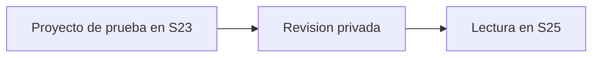

# MESTRY — Sintaxis ampliada r0001

## Código

```python
mensaje = "Prueba MESTRY: revisión desde el S25"
print(mensaje)
```

## Mermaid opcional



## HTML opcional

<strong>Texto de prueba en HTML</strong>

El renderizado de Mermaid y HTML se mide por separado. Que aparezcan como código o texto no se registra como soporte visual.
